# CoralFrame — Deep Codebase Documentation

> **AI-written from a full read of the source tree** (every application module, route, server action, executor, lib file, test, migration and config file was inspected; `components/ui/*` vendored primitives and `generated/prisma/*` were treated as boundaries, not analyzed line-by-line). This document replaces a bare README with a verified walkthrough of how CoralFrame actually works.
>
> Line references like [`lib/ssrf.ts:70`](lib/ssrf.ts#L70) point at the exact implementation. Where the code and the obvious intent diverge, the code wins and the discrepancy is called out. Where a judgment is an architectural interpretation rather than an observed fact, it is tagged:
>
> - **[Doc]** — explicitly documented in source comments, README, or `.env.example`
> - **[Impl]** — directly supported by implementation evidence
> - **[Inf]** — my interpretation / inference, not a documented decision
>
> Nothing in this document exposes secrets. `.env` values were never read into this document; only variable *names* are discussed.

---

## Table of Contents

1. [Project Overview](#1-project-overview)
2. [What This Software Actually Does](#2-what-this-software-actually-does)
3. [Technology Stack and Why Each Technology Exists](#3-technology-stack-and-why-each-technology-exists)
4. [Repository Structure Explained](#4-repository-structure-explained)
5. [Complete System Architecture](#5-complete-system-architecture)
6. [Application Components and Responsibilities](#6-application-components-and-responsibilities)
7. [Module-by-Module Documentation](#7-module-by-module-documentation)
8. [Function and Class Documentation](#8-function-and-class-documentation)
9. [Function Connectivity and Dependency Graphs](#9-function-connectivity-and-dependency-graphs)
10. [Core Execution Lifecycles](#10-core-execution-lifecycles)
11. [API and Communication Flows](#11-api-and-communication-flows)
12. [Database Architecture and Data Relationships](#12-database-architecture-and-data-relationships)
13. [State Management and Data Flow](#13-state-management-and-data-flow)
14. [Authentication and Security Architecture](#14-authentication-and-security-architecture)
15. [Background Jobs and Event Processing](#15-background-jobs-and-event-processing)
16. [External Integrations](#16-external-integrations)
17. [Architectural Decisions and Trade-offs](#17-architectural-decisions-and-trade-offs)
18. [Error Handling and Failure Scenarios](#18-error-handling-and-failure-scenarios)
19. [Important Configuration and Environment Variables](#19-important-configuration-and-environment-variables)
20. [Testing Architecture](#20-testing-architecture)
21. [Build, Startup, and Deployment Lifecycle](#21-build-startup-and-deployment-lifecycle)
22. [Potential Architectural Issues and Technical Debt](#22-potential-architectural-issues-and-technical-debt)
23. [Glossary of Important Concepts](#23-glossary-of-important-concepts)
24. [Appendix A — File Inventory and Analysis Status](#appendix-a--file-inventory-and-analysis-status)
25. [Appendix B — Verification Report](#appendix-b--verification-report)

---

## 1. Project Overview

**CoralFrame** is a visual, no-code builder for backend workflows and AI automations — "n8n built with a ruby-on-charcoal identity" ([README.md](README.md)). A user signs in, drags trigger/transform/AI/action nodes onto a canvas, wires them with edges, configures each node in an inspector panel, and CoralFrame executes the resulting graph server-side when a trigger fires (manual run, inbound webhook, Telegram update, or GitHub event).

The repository is a **single Next.js 16 application** (App Router, Cache Components) with:

- a **React 19 + XYFlow** canvas for graph editing,
- a **LangGraph**-compiled execution engine running inside an **Inngest** background function,
- a **Neon Postgres** database accessed through **Prisma 7**,
- **better-auth** for email/password + OAuth sign-in,
- real-time run telemetry over **Inngest Realtime** with a polling fallback.

It is **not** a monorepo (one deployable, one `package.json`), not a multi-service system, and not a library. The two commits so far are `cb2be0e` (Create Next App scaffold) and `acb2589` ("feat: CoralFrame — visual builder for backend workflows and AI automations"). The working tree also contains a large amount of uncommitted work-in-progress (execution engine, credentials, templates, realtime, AI nodes) layered on top of that commit — this document describes the **current working tree**, not `HEAD`.

What the product does for a user, concretely:

1. Sign in with email/password, Google, or GitHub.
2. Create a workflow from scratch or from one of 10 built-in templates.
3. Visually compose steps; the canvas autosaves (1.5 s debounce) to Postgres as JSON.
4. Activate the workflow; wire a webhook URL into GitHub/Telegram, or hit "Run now".
5. Watch nodes light up live (running → success/error) via realtime events, inspect per-step input/output in the Executions view, and retry failed runs.

## 2. What This Software Actually Does

Strip everything down to verified behavior:

**CoralFrame stores workflows as JSON graphs and interprets them.** There is no workflow "compiler" in the traditional sense — at execution time the stored `{nodes, edges}` JSON is re-parsed (`parseWorkflowGraph`, [app/modules/canvas/lib/parse-graph.ts:66](app/modules/canvas/lib/parse-graph.ts#L66)), compiled into an in-memory [LangGraph](https://langchain-ai.github.io/langgraphjs/) `StateGraph` ([app/modules/engine/lib/compile-workflow.ts:20](app/modules/engine/lib/compile-workflow.ts#L20)), and invoked once per run. Each node becomes one graph step that:

1. opens an `ExecutionStep` row (`RUNNING`) and publishes a realtime `node-status` event,
2. runs the node's executor ([app/modules/nodes/executors/index.ts:55](app/modules/nodes/executors/index.ts#L55)),
3. closes the step (`SUCCESS`/`ERROR`) with redacted-on-read input/output,
4. returns the next payload to the graph.

**The frontend is a faithful mirror of that engine.** The same node-type registry ([app/modules/nodes/lib/index.ts:36](app/modules/nodes/lib/index.ts#L36)) drives the palette, the canvas tiles, the inspector fields, and (indirectly) the executor table — one source of truth for "what steps exist".

**Secrets are designed never to reach the browser.** Node configs stored in Postgres may contain raw API tokens (legacy) or `credentialId` references to AES-256-GCM-encrypted rows in the `credential` table. Every read path that leaves the server — server actions returning graphs, execution snapshots, execution detail pages — passes through `redactValue` ([lib/redact.ts:20](lib/redact.ts#L20)). Decryption happens only inside server-side executors at run time ([lib/credentials.ts:131](lib/credentials.ts#L131)).

**Outbound automation HTTP calls** go through one SSRF-hardened fetch wrapper ([lib/ssrf.ts:121](lib/ssrf.ts#L121)) that validates protocol, resolves DNS and rejects private/link-local/metadata destinations on every redirect hop. Integration calls (Telegram, GitHub, Notion, Google Calendar, LLM providers) use plain `fetch` with explicit timeouts — they are fixed public HTTPS origins, not user-controlled URLs, with one exception noted in §16.

**Inbound triggers** are Webhook routes (`/api/webhooks/[workflowId]`, `…/github`, `…/telegram`) that authenticate the caller (optional shared secret / HMAC), rate-limit per workflow (120 req/min, in-memory), require the workflow to be `active`, find the matching trigger node in the stored graph, and hand a canonical `{body, headers, query}` payload to `dispatchExecution` ([app/modules/workflows/lib/dispatch-execution.ts:13](app/modules/workflows/lib/dispatch-execution.ts#L13)), which creates the `Execution` row and enqueues `workflow/triggered` on Inngest.

**Execution is asynchronous but not independent of the request.** The Inngest function [`executeWorkflow`](app/modules/inngest/functions/execute-workflow.ts#L5) is the only consumer of `workflow/triggered`. It calls `runWorkflow(executionId)` inside `step.run`. Progress is streamed to the canvas's `useExecutionRealtime`/`useExecutionPoll` overlay hooks; the DB (`Execution`, `ExecutionStep`) is the durable source of truth.

## 3. Technology Stack and Why Each Technology Exists

Versions are from [package.json](package.json); "why" is tagged **[Doc]** (stated in code/README), **[Impl]** (evident from usage), or **[Inf]** (inference).

| Layer | Technology | Version | Why it exists (as found) |
|---|---|---|---|
| Framework | Next.js (App Router, Cache Components, `partialPrefetching`) | 16.4.6 | Single deployable containing UI, server actions, route handlers, proxy. Cache Components + async pages inside `Suspense` is the app's prerender model; `instant = false` opts session-dependent pages out of instant-navigation validation — **[Doc]** ([next.config.ts](next.config.ts), comments in `(root)` pages) |
| UI runtime | React | 19.3.0 | Server components by default; client components for canvas, editor, forms |
| Language | TypeScript (strict) | 5.x | End-to-end type safety, `@/* → ./` path aliases |
| Canvas | `@xyflow/react` | 12.12.1 | Node graph rendering, connection handling, handles per node (`BaseNode`) |
| Styling | Tailwind CSS v4 + `@tailwindcss/turbopack` + `tw-animate-css` + custom OKLCH theme | 4.3.3 | Utility-first styling; theme tokens in [app/globals.css](app/globals.css) ("ruby on charcoal") |
| Component kit | vendored shadcn/base-ui primitives in `components/ui/` | — | 64 primitives copied into the repo; only 18 are actually imported by app code (see §22) — **[Impl]** |
| Auth | `better-auth` + `@better-auth/prisma-adapter` | 1.7.22 | Email/password + GitHub/Google OAuth; DB-backed sessions; `getSessionCookie` used by the proxy as a cheap gate — **[Doc]** |
| ORM | Prisma 7 (`prisma-client` generator, `@prisma/adapter-pg`) + `pg` | 7.10.1 | Schema-as-code; driver adapter over node-postgres; pooled `DATABASE_URL` at runtime, `DIRECT_URL` for migrations — **[Doc]** ([lib/prisma.ts](lib/prisma.ts), [prisma.config.ts](prisma.config.ts)) |
| Database | Neon (serverless Postgres) | — | Recommended by `.env.example`; not hard-wired — any Postgres works — **[Doc]** |
| Engine | `@langchain/langgraph` + `@langchain/core` + provider chat models | 1.7.4 | `StateGraph` gives conditional edges (IF/Switch) and a reducer-based state channel (`item`, `branch`, `nodeResults`) for free — **[Impl]** |
| AI providers | `@langchain/openai`, `@langchain/anthropic`, `@langchain/google-genai`, `@langchain/openrouter` | latest | One `BaseChatModel` interface for 4 providers, selected per node — **[Impl]** |
| Background jobs | `inngest` (+ `inngest-cli`) | 4.26.2 | Durable function execution, signing/verification, and **Realtime** pub/sub used for live node status — **[Doc]** |
| Realtime client | `useRealtime` from `inngest/react` | — | Subscribes to `execution:{id}` / topic `node-status` in the editor |
| Theming | `next-themes` | 0.4.6 | System/light/dark with class strategy |
| Motion | `gsap` + `@gsap/react` | 3.15.1 | Entrance choreography only (auth rail, list rows, stat counters); respects `prefers-reduced-motion` — **[Doc]** |
| Icons | `lucide-react`, `react-icons/si` (Simple Icons for brand glyphs) | 1.72.0 / 5.7.0 | Node tiles, UI chrome |
| Dates | `date-fns` | 4.4.0 | Formatting in Executions views |
| Highlighting | `shiki` (core, JS regex engine) | 4.6.0 | **Unused by app code** — feeds `lib/highlighter.tsx` → `hooks/use-highlighted-code.ts` → nothing (see §22) — **[Impl]** |
| Tests | `vitest` | 5.1.0 | 6 files, 57 tests, all passing (see §20) — **[Impl]** |
| Lint/format | ESLint 9 + `eslint-config-next` | 9 / 16.4.6 | `pnpm lint` |
| Package manager | pnpm | 12.9.1 | `pnpm-workspace.yaml` only allows *build scripts* allow/deny list; no workspace packages |

**Runtime environments:** Node.js 20+ (README). Next.js server on Node runtime (Proxy also defaults to Node runtime in Next 16). The browser runs the canvas, forms, and the realtime subscription; everything else is server-side.

## 4. Repository Structure Explained

```
coralframe/
├── proxy.ts                    # Next.js 16 "Proxy" (renamed middleware): session-cookie gate + security headers
├── next.config.ts              # cacheComponents, partialPrefetching, Turbopack→@tailwindcss/turbopack, agentFeedback
├── prisma.config.ts            # Prisma CLI (DIRECT_URL); prisma7.config.ts is a byte-identical duplicate
├── vitest.config.ts            # node env, @/ and @modules aliases
├── components.json             # shadcn config (base-vega style, zinc base)
├── app/
│   ├── layout.tsx              # root: fonts (Public_Sans/Instrument_Sans/Geist_Mono), metadata, ThemeProvider
│   ├── globals.css             # design tokens: OKLCH palette, aurora blobs, tile-raised, stat cells, keyframes
│   ├── error.tsx               # root client error boundary (reset + "go home")
│   ├── not-found.tsx           # 404
│   ├── (auth)/                 # sign-in route group (own layout: brand rail + aurora)
│   │   └── sign-in/page.tsx    # server component; requireUnAuth gate; Suspense skeleton
│   ├── (root)/                 # the product shell (own layout: skip link + h-dvh canvas)
│   │   ├── page.tsx            # dashboard: workflow list, 7d stats, GSAP counters
│   │   ├── workflows/[id]/     # editor route (getWorkflow → WorkflowEditor + WorkflowBuilder)
│   │   ├── executions/         # runs list + [id] detail (step timeline, redacted IO, retry)
│   │   ├── templates/          # 10 built-in starter workflows
│   │   ├── credentials/        # AES-256-GCM credential vault UI
│   │   └── loading.tsx         # dashboard skeleton (Suspense fallback for Cache Components)
│   ├── api/
│   │   ├── auth/[...all]/      # better-auth handler (toNextJsHandler)
│   │   ├── inngest/            # Inngest serve endpoint (executeWorkflow) — maxDuration=300
│   │   ├── realtime-token/     # mints channel-scoped subscribe token for the caller's execution
│   │   ├── webhooks/[workflowId]/{route.ts,github/route.ts,telegram/route.ts}
│   │   └── workflow/[workflowId]/execution-snapshot/route.ts
│   └── modules/                # feature modules (see §7). The unit of organization.
│       ├── auth/               # server actions (getCurrentUser…), sign-in form, user button
│       ├── canvas/             # XYFlow canvas, hooks, graph parse/serialize, contexts
│       ├── credentials/        # credential actions + manager UI
│       ├── engine/             # LangGraph compile + step execution + JSON sanitizers
│       ├── inngest/            # client, event types, functions, realtime channel + publisher
│       ├── nodes/              # node registry, icon tiles, 13 executors
│       ├── openrouter/         # model catalogue (server-cached) + picker
│       ├── templates/          # template gallery + instantiate action
│       └── workflows/          # dashboard components + server actions + webhook/dispatch lib
├── components/
│   ├── ui/                     # 64 vendored primitives (18 used; see §22)
│   ├── brand-mark.tsx          # BrandMark/BrandWordmark (Flame glyph, ruby gradient)
│   ├── copy-button.tsx         # clipboard copy w/ feedback
│   ├── mode-toggle.tsx         # re-export of components/ui/mode-toggle
│   └── theme-provider.tsx      # next-themes wrapper
├── lib/                        # server-side core: prisma, auth, crypto, redaction, SSRF guard, utils
├── hooks/                      # use-mobile (sidebar-only), use-highlighted-code (unused)
├── generated/prisma/           # Prisma 7 client (gitignored; produced by `prisma generate`)
├── prisma/                     # schema.prisma + 4 migrations + migration_lock.toml
└── public/                     # intentionally empty (favicon lives at app/favicon.ico)
```

Notable absences: no `src/` directory; no `middleware.ts` (renamed `proxy.ts`); no `app/api/*` for CRUD — all mutations flow through **server actions**; no separate backend package.

## 5. Complete System Architecture

### 5.1 The whole system in one picture

CoralFrame is one Next.js process serving both the React UI and all backend behavior. Persistence is Neon Postgres (via Prisma, pooled connection). Background execution and realtime fan-out go through Inngest (a separate service the app talks to over HTTPS/WebSocket; in dev, a local `inngest-cli dev` server). LLM calls go to one of four providers, selected per node.

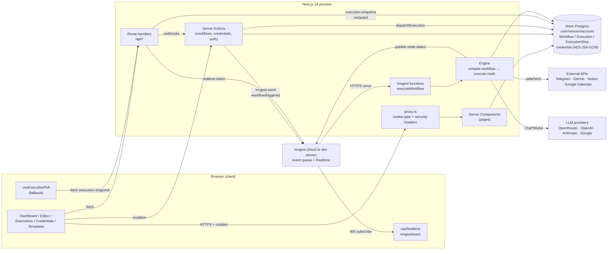

**Reading the diagram:** the webhook routes and Inngest are the only paths from "outside the session" into the engine. The dashboard never executes a workflow; it only *dispatches* one (`dispatchExecution` creates the `Execution` row, then `inngest.send` hands it to Inngest). Everything that leaves the server toward the browser passes through `redactValue`.

### 5.2 Subsystems and how they communicate

| Subsystem | Responsibility | Talks to |
|---|---|---|
| `app/(auth)` + `modules/auth` | Sign-in/up UI, session lookup, sign-out | proxy, better-auth, DB |
| `app/(root)` | Shell routes: dashboard, editor, executions, templates, credentials | server actions, canvas |
| `modules/canvas` | XYFlow graph editing, autosave, live execution overlay | workflows actions, execution-snapshot API, realtime API |
| `modules/workflows` | Server actions (CRUD, stats, dispatch, retry), list UI | prisma, dispatch-execution, canvas save pipeline |
| `modules/nodes` | Node registry + executors | engine, credentials lib, external APIs |
| `modules/engine` | LangGraph compile + per-step execution | nodes executors, prisma, inngest realtime publisher |
| `modules/inngest` | Inngest client, events, functions, realtime channel | Inngest serve route, engine |
| `modules/credentials` + `lib/credentials.ts` | Encrypted vault (AES-256-GCM) | prisma, executors (server-side only) |
| `modules/templates` | 10 curated starter graphs | prisma (workflow create) |
| `modules/openrouter` | Model catalogue cache | OpenRouter public API |
| `lib/*` | prisma singleton, auth config, SSRF guard, redaction, Google OAuth refresh | all server code |

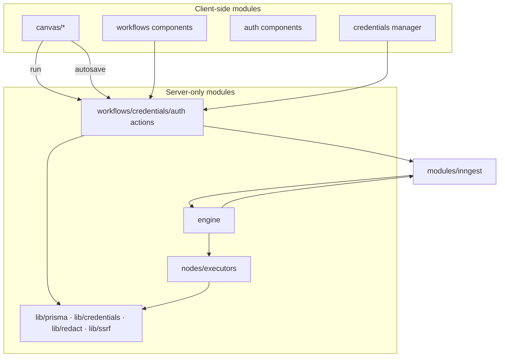

**Dependency direction is one-way**: client → server actions → lib / engine → executors → lib. Engine and executors never import client modules. `lib/` never imports from `app/`.

### 5.3 Infrastructure and integration diagram

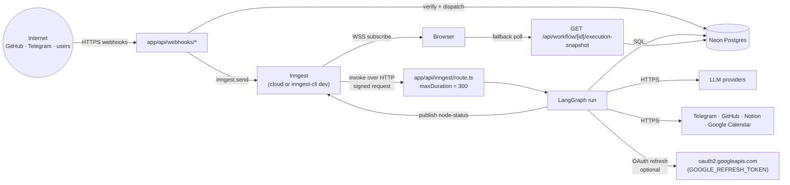

Operational notes:

- **Inngest in dev** needs the dev server (`pnpm dlx inngest-cli dev` or the `inngest-cli` dependency) pointed at `http://localhost:3000/api/inngest`; [.env](.env) carries `INNGEST_DEV` locally (name only, value unstated here). Without it, `inngest.send` fails and `dispatchExecution` closes the `Execution` row as `ERROR` with an explanatory `data.error` ([app/modules/workflows/lib/dispatch-execution.ts:18-40](app/modules/workflows/lib/dispatch-execution.ts#L18)).
- **Inngest in prod** needs `INNGEST_EVENT_KEY` / `INNGEST_SIGNING_KEY`, which are absent from `.env.example` (see §19/§22).
- The webhook routes are deliberately **public** to the proxy (session gate does not apply; webhooks carry no cookies) and rely on per-node secrets + HMAC instead — verified working as coded, see §14.

### 5.4 Data-flow diagram — graph in, run out

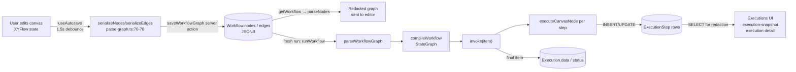

Every arrow crossing a trust boundary carries redacted data; the only hop that sees plaintext secrets is the executor inside the engine process.

## 6. Application Components and Responsibilities

The app is organized into **route groups** (`(auth)`, `(root)`) and **feature modules** (`app/modules/*`). Components are React function components; most are client components (`"use client"`) because the product is interactive.

| Route | Component(s) | Responsibility |
|---|---|---|
| `/` (dashboard) | [app/(root)/page.tsx](app/(root)/page.tsx) | Auth-gated dashboard: stats strip (`StatValue` GSAP counters), `WorkflowList` (client-side search filter + table), `DashboardRail` nav, `NewWorkflowButton` |
| `/workflows/[id]` | [app/(root)/workflows/[id]/page.tsx](app/(root)/workflows/[id]/page.tsx) → `WorkflowEditor` + `WorkflowBuilder` | Loads redacted graph, renders nav (run toggle, activation switch, delete), mounts the canvas |
| `/executions` | [app/(root)/executions/page.tsx](app/(root)/executions/page.tsx) | Last 30 runs across the workspace |
| `/executions/[id]` | [app/(root)/executions/[id]/page.tsx](app/(root)/executions/[id]/page.tsx) + `RetryExecutionButton` | Step timeline; redacted JSON IO per step; retry |
| `/templates` | [app/(root)/templates/page.tsx](app/(root)/templates/page.tsx) + `TemplateGallery` | 10 starter graphs; `UseTemplateButton` → `createWorkflowFromTemplate` |
| `/credentials` | [app/(root)/credentials/page.tsx](app/(root)/credentials/page.tsx) + `CredentialsClient` | List/create/delete AES-256-GCM credentials; values never round-trip |
| `/sign-in` | [app/(auth)/sign-in/page.tsx](app/(auth)/sign-in/page.tsx) + `SigninForm` | Email/password + OAuth; `requireUnAuth` gate; `safeCallbackURL` same-origin enforcement |

**Shared UI primitives actually used by the app** (of the 64 vendored ones; verified by import scan): `alert-dialog, avatar, badge, button, card, dialog, dropdown-menu, empty, input, label, mode-toggle, popover, select, separator, spinner, switch, table, textarea` — plus app-local `BrandMark`, `CopyButton`, `ModeToggle` (re-export of the ui primitive), `ThemeProvider`.

**Provider tree (client):** root layout → `ThemeProvider` → route group layout → page (`ExecutionOverlayProvider` + `SaveStatusProvider` scoped to the editor only, in [app/modules/workflows/components/workflow-editor.tsx:107-108](app/modules/workflows/components/workflow-editor.tsx#L107)).

**Data components vs presentational components:** pages and server actions own data access; everything under `components/` renders passed-in props. There is no client-side data fetching library — mutations are server actions, and the only client polling is the execution-snapshot fallback (§10.6).

## 7. Module-by-Module Documentation

Each entry: why the module exists · responsibility · key exports · upstream users · downstream dependencies.

### 7.1 `app/modules/auth` — sessions, gates, sign-in UI

**Why it exists:** every part of the product is per-user; this module is the only source of "who is calling".

- **`app/modules/auth/actions/index.ts`** — server actions, all wrapped around `auth.api.getSession`:
  - `getCurrentUser` ([:8](app/modules/auth/actions/index.ts#L8)) — `cache()`-deduplicated per request; returns `session?.user ?? null`.
  - `requireAuth` ([:15](app/modules/auth/actions/index.ts#L15)) — redirects to `/sign-in` when anonymous. Used by every other server action.
  - `requireUnAuth` ([:24](app/modules/auth/actions/index.ts#L24)) — inverse; used by the sign-in page.
  - `signIn` ([:32](app/modules/auth/actions/index.ts#L32)) — `disableRedirect: true` OAuth start; returns the provider URL (only caller: sign-in form's social buttons — actually the form calls `authClient.signIn.social` directly; this action is currently unconsumed by app code — see §22).
  - `signOut` ([:44](app/modules/auth/actions/index.ts#L44)) — server sign-out + **explicit deletion of six auth cookies** ([:51-59](app/modules/auth/actions/index.ts#L51)) because the proxy would otherwise keep believing a logged-out user is authenticated ("bounced the sign-in page back to `/` in a loop" — code comment). Ends with `redirect('/sign-in')`.
- **`app/modules/auth/components/sign-in-form.tsx`** — the whole sign-in/up card: GSAP-animated segmented control, error-summary focus management, per-field validation (name/email/password≥8/confirm), social buttons calling `authClient.signIn.social`, email submit calling `authClient.signIn/signUp.email`. Deliberately client-side; server action not needed because better-auth's client talks to `/api/auth/*`.
- **`app/modules/auth/components/user-button.tsx`** — avatar dropdown: account snapshot (initials, verified badge), copyable short user ID, sign-out via the `signOut` action.

**Depends on:** `@/lib/auth` (server), `@/lib/auth-client` (browser), `lib/prisma` (via lib/auth). **Consumed by:** virtually every page and action.

### 7.2 `app/modules/canvas` — the editor

The largest module by interaction complexity. Four sub-areas:

**`lib/`** — framework-free graph logic (unit-testable, reused server-side):
- [types.ts](app/modules/canvas/lib/types.ts) — `WorkflowNode`/`WorkflowEdge` (XYFlow generics), `WorkflowNodeData` (`label`, `nodeType`, `config: Record<string,string>`, `status?`), `WORKFLOW_NODE_TYPE = "workflow"`.
- [parse-graph.ts](app/modules/canvas/lib/parse-graph.ts) — `parseNodes`/`parseEdges` (validate + **strip ephemeral fields** `selected`/`measured`/`zIndex` — rows saved before autosave narrowed its diff could carry them), `parseWorkflowGraph` (engine's entry), `serializeNodes`/`serializeEdges` (canonical autosave comparison targets). Invalid entries are **dropped silently**, never thrown.
- [create-node.ts](app/modules/canvas/lib/create-node.ts#L4) — builds a `WorkflowNode` with `crypto.randomUUID()`; `ai` nodes default `config.provider = "openrouter"`.
- [edge-types.ts](app/modules/canvas/lib/edge-types.ts#L4) — deterministic-ish edge ids `edge-{source}-{target}-{sourceHandle}-{targetHandle}`.

**`hooks/`**:
- [use-autosave.ts](app/modules/canvas/hooks/use-autosave.ts#L17) — debounced (1.5 s) persistence; baseline on first run; saves only when the *canonical serialization* changed; flips `SaveStatus` via callback. Deliberately ignores XYFlow's ephemeral interaction state.
- [use-execution.ts](app/modules/canvas/hooks/use-execution.ts#L41) — `useExecutionRealtime`: subscribes to topic `node-status` on `execution:{id}` via `useRealtime`; token fetched from `/api/realtime-token?executionId=`; merges messages into overlay via `applyNodeStatus` ([:18](app/modules/canvas/hooks/use-execution.ts#L18)).
- [use-execution-poll.ts](app/modules/canvas/hooks/use-execution-poll.ts#L22) — fallback poller: every 1200 ms fetches the snapshot route; merges; stops at terminal status; backs off to 2500 ms on errors; dormant while realtime status is `open`.

**`components/`**:
- [workflow-builder.tsx](app/modules/canvas/components/workflow-builder.tsx#L41) — the orchestrator: holds `useNodesState`/`useEdgesState`, palette collapse (localStorage + `useSyncExternalStore`), `addNodeAtCenter` with cascade offset, render-time state reconciliation (selected node deleted → deselect; selection → reopen inspector; run finished → 5 s dismissible terminal chip), layout: palette | canvas (+status chips) | inspector.
- [canvas.tsx](app/modules/canvas/components/canvas.tsx#L28) — the `<ReactFlow>` surface: single `nodeTypes` map (`workflow` → `BaseNode`), single `edgeTypes` map (`workflow` → `WorkflowEdgeComponent`), drop handler for palette drags (`application/x-coralframe-node`), `deleteKeyCode="Backspace"`, minZoom .3 / maxZoom 1.75, minimap, theme-aware `colorMode`.
- [nodes/base-node.tsx](app/modules/canvas/components/nodes/base-node.tsx#L65) — the one node renderer: icon tile, label, live status glyph (lucide spinner/check/X + `cf-node-pop` animation), hover error tooltip, delete button, per-type source handles (IF: true/false; Switch: one per case + `default`; else registry outputs), target handle hidden for triggers.
- [node-config-panel.tsx](app/modules/canvas/components/node-config-panel.tsx#L42) — the inspector: registry-driven form fields, credential dropdown (filters AI providers for AI nodes), secret fields become read-only "Provided by credential" when a `credentialId` is set, `{{field}}` token picker fed by **upstream** sample fields, run-error banner from the overlay.
- [execution-context.tsx](app/modules/canvas/components/execution-context.tsx#L37) — `ExecutionOverlayProvider`: owns `executionId` + overlay map; merges realtime + poll; **adopts the latest run on mount** (mid-run refresh survival); `startRun` calls `triggerWorkflow`. `useExecutionOverlay` falls back to an inert overlay outside the provider.
- [save-status-context.tsx](app/modules/canvas/components/save-status-context.tsx) / [save-indicator.tsx](app/modules/canvas/components/save-indicator.tsx) — `idle → saving → saved | error` bridge between autosave and the nav pill.
- [node-palette.tsx](app/modules/canvas/components/node-palette.tsx) — searchable, categorized (trigger/transform/AI/action) draggable step library; collapses to a 64 px rail; state persisted in `localStorage` (`coralframe:palette-collapsed`).
- [field-picker.tsx](app/modules/canvas/components/field-picker.tsx), [canvas-empty-state.tsx](app/modules/canvas/components/canvas-empty-state.tsx) — `{{token}}` inserter; empty canvas hero.
- [run-workflow-button.tsx](app/modules/canvas/components/run-workflow-button.tsx) — **dead file**: contains only `"use client"`; no component, no imports (see §22).
- [edges/workflow-edge.tsx](app/modules/canvas/components/edges/workflow-edge.tsx) — smooth-step edge; colors by upstream node status (amber pulse "active" with dashed-flow overlay, emerald "done", destructive "error", border "idle"); optional branch label pill.

### 7.3 `app/modules/nodes` — registry + executors

**`app/modules/nodes/lib/index.ts`** — the single source of truth for "what steps exist" ([:36](app/modules/nodes/lib/index.ts#L36)): `NODE_TYPES` (13 entries — see table in §8.7), `getNode`, `getConfigField`, `getSampleFields`, `CATEGORY_ACCENT`, plus unused aliases `NODE_REGISTRY`/`getNodeDefinition` ([:254-256](app/modules/nodes/lib/index.ts#L254)).

**`app/modules/nodes/components/node-icon.tsx`** + **`node-tile.tsx`** — Lucide glyphs per node type + brand tiles (Simple Icons: Telegram/GitHub/Notion/Google Calendar with official colors) rendered at xs–lg sizes.

**`executors/`** — the runtime half of the registry. `runNode` ([executors/index.ts:55](app/modules/nodes/executors/index.ts#L55)) dispatches by `node.data.nodeType`; unknown types throw (fail-closed, no silent passthrough):

| Node type | Executor | Behavior summary |
|---|---|---|
| `manual-trigger` | `manualTrigger` | Parses configured `testJson` object as the payload; blank → `{}`; invalid → step error |
| `webhook-trigger` / `telegram-trigger` / `github-trigger` | `triggerExecutor` | Identity: pass the ingress payload through |
| `http-request` | `httpRequest` | Method allowlist, interpolated URL, JSON-parsed headers, SSRF-safe fetch, `{status, body, headers}` envelope **replaces** payload; non-2xx → step error with 200-char body excerpt |
| `if` | `ifExecutor` | Interpolates condition, finds first known operator, numeric-aware comparison, `branch` = `true`/`false` |
| `switch` | `switchExecutor` | Exact-match routed `branch`, else `default` |
| `set-field` | `setField` | `field: value` lines, `#` comments, dot-path nesting, `{{tokens}}` interpolated; merged over incoming item |
| `ai` | `aiExecutor` | Provider key resolution (credential → inline → env), LangChain chat model invoke, `{...item, response}` |
| `telegram-send` | `telegramSend` | Bot API `sendMessage`; output `{ok, message_id, chat_id, text}` merged into item |
| `github-create-issue` | `githubCreateIssue` | `owner/repo` parsing (accepts https URL or `owner/name`), POST issue |
| `notion-create-page` | `notionCreatePage` | POST `/v1/pages` with `Name` title property only (minimal) |
| `google-calendar-event` | `googleCalendarEvent` | Token: explicit → credential → env refresh-token exchange (`lib/google-oauth.ts`); validates RFC3339 start/end |

### 7.4 `app/modules/engine` — from JSON to a running graph

- **[state.ts](app/modules/engine/lib/state.ts#L8)** — LangGraph `Annotation.Root`: channels `item` (incoming payload; later wins), `branch` (edge routing key; later wins), `nodeResults` (merged map of per-node outcomes).
- **[compile-workflow.ts](app/modules/engine/lib/compile-workflow.ts#L20)** — finds the trigger (first node whose type is in `TRIGGER_TYPES`), registers **all** nodes in one `addNode(actions)` call (so the node-name union infers as `string`, not `never` — code comment), wires `START → trigger`, conditional edges for `if`/`switch` (branch value → path map from `edge.sourceHandle ?? edge.data?.branch ?? "default"`), plain edges otherwise, and any node without outgoing edges → `END`.
- **[execute-node.ts](app/modules/engine/lib/execute-node.ts#L24)** — `executeCanvasNode`: creates the `ExecutionStep` (RUNNING) → publishes realtime → runs `runNode` → closes step (SUCCESS with sanitized output / ERROR with message truncated to 1000 chars) → returns LangGraph partial state. Any throw fails the whole run.
- **[run-workflow.ts](app/modules/engine/lib/run-workflow.ts#L14)** — loads execution + workflow, parses the graph, compiles, `app.invoke({item: sanitized execution.data …})`, marks `Execution` SUCCESS (storing final item in `data`) or ERROR, and rethrows so Inngest sees the failure.
- **[template.ts](app/modules/engine/lib/template.ts#L1)** — `interpolate("{{a.b}}", item)`: dot-path walk, arrays by index, missing → `""`. Deliberately not an expression evaluator.
- Postgres-JSON hardening (`sanitizeForJson`, duplicated in both engine files): strips U+0000 and lone surrogates so binary-ish payloads can't blow up JSONB writes.

### 7.5 `app/modules/inngest` — events, functions, realtime

- [client.ts](app/modules/inngest/client.ts) — `new Inngest({ id: "coralframe" })`.
- [events.ts](app/modules/inngest/events.ts#L4) — typed event `workflow/triggered`: `{ workflowId, executionId, trigger, input? }`.
- [functions/execute-workflow.ts](app/modules/inngest/functions/execute-workflow.ts#L5) — `inngest.createFunction({id: "execute-workflow", triggers: [workflowTriggered]}, …)` → `step.run("run-workflow", () => runWorkflow(executionId))`.
- [functions/index.ts](app/modules/inngest/functions/index.ts) — barrel; consumed by the serve route.
- [realtime/channels.ts](app/modules/inngest/realtime/channels.ts#L4) — `executionChannel({executionId})` → name `execution:{id}`, one topic `node-status` with a static schema `{nodeId, status: "running"|"success"|"error", output?, error?}`.
- [realtime/publish-node-status.ts](app/modules/inngest/realtime/publish-node-status.ts#L11) — best-effort publish; **failures are swallowed with `console.warn`** — realtime is enhancement, not source of truth.
- [app/api/inngest/route.ts](app/api/inngest/route.ts#L6) — `serve({client, functions: [executeWorkflow]})`, `maxDuration = 300`.

### 7.6 `app/modules/workflows` — server actions + dashboard

**[actions/index.ts](app/modules/workflows/actions/index.ts)** — every mutation/query the UI uses; all read paths return **redacted** graphs:
- Queries: `getWorkflows` (with last execution), `getWorkflow`, `getExecutions` (30 max), `getExecution` (redacted steps), `getWorkflowStats` (groupBy active/status over 7 days).
- Mutations: `createWorkflow` (redirects into editor), `renameWorkflow` (updateMany scoped to owner; empty → "untitled workflow"), `deleteWorkflow` (updateMany scoped; redirects `/`), `toggleActive`, `saveWorkflowGraph` (updateMany scoped; logs failure),
- `triggerWorkflow` → `dispatchExecution(workflowId, "MANUAL")`, `retryExecution` → dispatch with the stored `execution.data` + original trigger, **linked via `retryOfId`** (self-FK), then redirect to the new run.

**[lib/dispatch-execution.ts](app/modules/workflows/lib/dispatch-execution.ts#L13)** — creates `Execution(RUNNING)` **then** `inngest.send`; on send failure closes it `ERROR` with a human hint and returns `{error}` (never throws) — callers translate to 502/UI error.

**[lib/webhook.ts](app/modules/workflows/lib/webhook.ts)** — the ingress toolkit: `safeEqual` (length-then-`timingSafeEqual`), `sign256` (HMAC-SHA256 hex, `sha256=`-prefixed), `readJsonBody` (256 KB cap → `"Webhook body too large"`), `checkRateLimit` (fixed-window 120/min, per key, in-memory), `headerMap`/`queryMap` (secret-stripping header whitelist), `webhookItem` (canonical `{body, headers, query}`), `findTriggerNode`.

**Components:** `workflow-list` (search + empty states), `workflow-row` (toggle, delete confirm, last-run badge), `workflow-editor` (nav shell: run button, activation `Switch` with `useOptimistic`, delete dialog), `top-nav`, `dashboard-rail` (icon nav: Workflows/Templates/Executions/Credentials), `rename-workflow` (inline edit, optimistic), `new-workflow-button` (dialog → server action), `stat-value` (GSAP count-up).

### 7.7 `app/modules/credentials` — the vault

- **`app/modules/credentials/actions/index.ts`** ([:1-52](app/modules/credentials/actions/index.ts)) — `listWorkspaceCredentials`, `createWorkspaceCredential` (trims, drops empty key/values, requires ≥1 secret), `updateWorkspaceCredential` (partial re-encrypt when payload provided), `deleteWorkspaceCredential` (deleteMany scoped to owner), `redactWorkflowGraph` (helper; unused — see §22).
- **`app/modules/credentials/components/credentials-manager.tsx`** — `CredentialsClient`: list (metadata only), create dialog (provider dropdown, single key/value pair per creation), delete confirmation. The value input is `type="password"`; **the value is never rendered back**.

### 7.8 `app/modules/openrouter` — model catalogue

- **`app/modules/openrouter/lib/catalogue.ts`** ([:46](app/modules/openrouter/lib/catalogue.ts#L46)) — server-only fetch of `https://openrouter.ai/api/v1/models` (public); 5-minute module-level cache; on failure serves stale with `stale: true`, else error. Free models first, newest first.
- **`app/modules/openrouter/actions/index.ts`** — `getOpenRouterCatalogue` (auth-gated).
- **`app/modules/openrouter/components/openrouter-model-select.tsx`** — searchable/ filterable (all/free/paid) popover picker; degrades offline with retry; used by the AI node's `model` field (openrouter provider only).

### 7.9 `app/modules/templates` — starter graphs

- **`app/modules/templates/lib/templates.ts`** ([:52](app/modules/templates/lib/templates.ts#L52)) — 10 templates (GitHub→AI→Telegram, issue triage, webhook→AI→issue/Telegram, digest, Notion capture, changelog, supervisor patterns, IF fan-out, Switch router). Built with the same `getNode` registry; ids are static.
- **`app/modules/templates/actions/index.ts`** ([:14](app/modules/templates/actions/index.ts#L14)) — `createWorkflowFromTemplate`: copies template nodes/edges verbatim into a new `Workflow` row (owner-scoped), redirects to the editor. Template content is compiled into the app, never taken from the request.
- **Components:** `template-gallery` (tabs + search + cards), `use-template-button` (instantiate + redirect).

### 7.10 `lib/` — server-side foundation

| File | Exports | Role |
|---|---|---|
| [prisma.ts](lib/prisma.ts) | `prisma` | Singleton `PrismaClient` over `@prisma/adapter-pg` (`PrismaPg`) on pooled `DATABASE_URL`; cached on `globalThis` in dev to survive HMR |
| [auth.ts](lib/auth.ts) | `auth` | better-auth instance; Prisma adapter; `session.cookieCache` (5 min); email+password; GitHub/Google with placeholder fallbacks |
| [auth-client.ts](lib/auth-client.ts) | `authClient`, `signIn`, `signUp`, `useSession`, `signOut` | Browser better-auth client; baseURL from `window.location.origin` |
| [credentials.ts](lib/credentials.ts) | `encryptCredential`, `decryptCredential`, `listCredentials`, `createCredential`, `updateCredential`, `deleteCredential`, `resolveCredential`, `resolveConfigSecret`, `getEncryptionKey` | AES-256-GCM vault; see §8.5 |
| [redact.ts](lib/redact.ts) | `redactValue`, `redactGraph` (unused), `redactJson` | Recursive masking of secret-shaped keys/values; depth cap 12 |
| [ssrf.ts](lib/ssrf.ts) | `checkUrlSafety`, `safeFetch` | SSRF guard + per-hop redirect re-validation; see §8.6 |
| [google-oauth.ts](lib/google-oauth.ts) | `refreshGoogleAccessToken` | Refresh-token → access-token exchange (10 s timeout) |
| [credential-validation.ts](lib/credential-validation.ts) | `testCredential` (server action) | Owner-scoped "Test" button backend: decrypts the payload server-side then pings each provider's lightest read endpoint (GitHub `/user`, Notion `/users/me`, Telegram `getMe`, OpenRouter `/credits`, OpenAI `/models`, Anthropic `/models`, Google `models`, Google Calendar refresh+calendarList). Never returns secret material. Wired nowhere yet — the credentials UI has no caller as of this analysis |
| [highlighter.tsx](lib/highlighter.tsx) | `loadHighlighter`, `highlightCode` | Shiki wrapper — **unused by app code** (see §22) |
| [utils.ts](lib/utils.ts) | `cn` | Re-exports `cn` from the `cn` package |

### 7.11 Special files at the root

- **[proxy.ts](proxy.ts)** — Next.js 16 Proxy (formerly middleware). Regex-gated session-cookie check for `/`, `/dashboard*`, `/settings*`, `/profile*`, `/admin*` + security headers on every matched response. **Measured behavior: it matches almost nothing in this app** (see §14.4 and §22.1 — this is the single most surprising finding of the analysis).
- **`generated/prisma/`** — Prisma 7 `prisma-client` output (gitignored). `lib/prisma.ts` imports from here, not from `@prisma/client`.
- **`.env` / `.env.bak`** — local secrets, gitignored (`.env*` pattern). Only names are documented here (§19).
- **`skills-lock.json`, `.agents/`, `.claude/`, `.codex/`, `.opencode/`, `.windsurf/`** — AI coding-agent tooling; explicitly gitignored, not part of the product.

## 8. Function and Class Documentation

### 8.1 `compileWorkflow` — graph compilation, block by block

[app/modules/engine/lib/compile-workflow.ts:20-62](app/modules/engine/lib/compile-workflow.ts#L20)

```ts
export function compileWorkflow(
    nodes: WorkflowNode[],
    edges: WorkflowEdge[],
    executionId: string,
    userId: string,
) {
    const trigger = findTrigger(nodes);
    if (!trigger) throw new Error("Workflow need a trigger node")
```

The function signature tells you the trust model immediately: it needs the parsed graph, the `executionId` (for step bookkeeping), and `userId` (for credential resolution). First line: find the trigger — `nodes.find(n => TRIGGER_TYPES.includes(n.data.nodeType))` ([:14](app/modules/engine/lib/compile-workflow.ts#L14)). Only the four trigger node types qualify. If there is none, compilation fails and `runWorkflow` marks the execution `ERROR` — there is no half-run.

```ts
    const actions: Record<string, (state) => Promise<Partial<WorkflowStateType>>> = {};
    for (const node of nodes) {
        actions[node.id] = async (state) => executeCanvasNode(state, node, executionId, userId);
    }
    const graph = new StateGraph(WorkflowState).addNode(actions);
```

Every node — trigger or not — becomes a no-argument closure over its own `executeCanvasNode`. Why one `addNode` call instead of chained `.addNode()`s: the comment at [:33-35](app/modules/engine/lib/compile-workflow.ts#L33) explains that chaining would leave the node-name union as `never`, which would make `addEdge(START, trigger.id)` a type error. Single call → union infers as `string`.

```ts
    graph.addEdge(START, trigger.id);
    const conditionalSources = new Set<string>();
    for (const node of nodes) {
        if (!CONDITIONAL_TYPES.has(node.data.nodeType)) continue;
        const outgoing = edges.filter((edge) => edge.source === node.id);
        const pathMap: Record<string, string> = {};
        for (const edge of outgoing) {
            const branch = edge.sourceHandle ?? edge.data?.branch ?? "default";
            pathMap[branch] = edge.target;
        }
        graph.addConditionalEdges(node.id, (state) => state.branch || "false", pathMap)
        conditionalSources.add(node.id);
    }
```

Conditional nodes (`if`, `switch`) are special: each outgoing edge's `sourceHandle` (the IF/Switch handle id: `true`, `false`, or a case label) becomes the routing key. LangGraph evaluates the router function — `state.branch || "false"` — and follows `pathMap[branch]`. Note the asymmetry: `if` without an explicit "false" edge keys off `"false"`, matching the executor's `branch: result ? "true" : "false"` exactly. If a branch has no edge, LangGraph routes to that key's (missing) mapping — i.e., the run silently takes no branch and ends at END via the missing-outgoing rule below. (LangGraph throws on an unknown path key mapped to undefined; treat unmapped branches as terminal.)

```ts
    for (const edge of edges) {
        if (conditionalSources.has(edge.source)) continue;
        graph.addEdge(edge.source, edge.target)
    }
    for (const node of nodes) {
        const hasOutgoing = edges.some((edge) => edge.source === node.id);
        if (!hasOutgoing) graph.addEdge(node.id, END)
    }
    return graph.compile()
```

Plain edges become static edges; conditional sources are skipped because their routing is handled by `addConditionalEdges`. Terminals (no outgoing edges) connect to `END`. **Cycles are permitted** — nothing prevents a workflow that loops back forever; each pass creates fresh step rows. LangGraph has no step budget here (see §22).

**Error handling:** `graph.compile()` itself throws on malformed input (e.g., dangling edge targets, duplicate conditional keys). That propagates to `runWorkflow`'s catch → `ERROR`.

### 8.2 `executeCanvasNode` — the unit of execution

[app/modules/engine/lib/execute-node.ts:24-72](app/modules/engine/lib/execute-node.ts#L24)

```ts
    const input = (state.item ?? {}) as Record<string, unknown>;
    const step = await prisma.executionStep.create({ ... status: "RUNNING", error: "", startedAt });
    await publishNodeStatus(executionId, { nodeId: node.id, status: "running" });
```

1. Snapshot the incoming payload — note this **shares the object reference** with `state.item` (no clone). Executors mutate `next = { ...item }` (shallow copies) rather than the input itself, so the next node sees a *copy-on-write* view.
2. Create the step row **before** running anything, with `error: ""` (required by schema — `error String` is non-nullable).
3. Announce `running` — realtime is fire-and-forget; a missing Inngest dev server only logs a warning.

```ts
    try {
        const result = await runNode({ node, item: input, executionId, userId });
        const output = result.output ?? result.item ?? {};
        const nextItem = (result.item ?? input) as Record<string, unknown>;
        await prisma.executionStep.update({ where: { id: step.id }, data: {
            status: "SUCCESS", output: sanitizeForJson(output) as never, finishedAt } });
        await publishNodeStatus(executionId, { nodeId: node.id, status: "success", output });
        return { item: nextItem, branch: result.branch ?? state.branch, nodeResults: { ... } };
    } catch (error) {
        ...status: "ERROR", error: message.slice(0, 1000)...   // truncated, DB-safe
        await publishNodeStatus(executionId, { nodeId: node.id, status: "error", error: message });
        throw error;   // fail the whole run
    }
```

Key subtleties:

- `branch: result.branch ?? state.branch` — a non-conditional node preserves the incoming branch key. This is what lets an IF node route *through* a chain of action nodes: the branch value set at the IF node flows until an END. (Worth noting: downstream action nodes can technically overwrite `branch` if they return one — none do.)
- `nodeResults` merges `{ ...state.nodeResults, [node.id]: {status, output} }` — the full run's per-node outputs are accumulated in the final LangGraph state, though `runWorkflow` only persists `result.item` into `Execution.data` — **nodeResults are not stored on the execution row**; per-node IO lives exclusively on `ExecutionStep`.
- `sanitizeForJson` ([:11-19](app/modules/engine/lib/execute-node.ts#L11)) strips NUL and lone surrogates (Postgres `json` rejects them) before every JSONB write.
- Any executor throw → step row marked `ERROR` with a truncated message → `throw` → LangGraph aborts → `runWorkflow`'s catch marks `Execution` `ERROR`. Partial progress remains inspectable via steps.

### 8.3 `runWorkflow` — the Inngest entry point

[app/modules/engine/lib/run-workflow.ts:14-46](app/modules/engine/lib/run-workflow.ts#L14)

1. `prisma.execution.findUniqueOrThrow({ include: { workflow: true } })` — the workflow is loaded **fresh at run time**, so mid-run edits apply to the next run, not this one. Actually since `app.invoke` happens microseconds later, "mid-run" mostly means: whatever was committed when the function reached the DB.
2. `parseWorkflowGraph(workflow.nodes, workflow.edges)` — stored JSON → typed graph; invalid fragments silently dropped.
3. `compileWorkflow(...)` then `app.invoke({ item: execution.data ?? {}, branch: "", nodeResults: {} })` — the original trigger payload is the run's seed. A manual run seeded with the retry button's `execution.data` re-feeds the original input.
4. On success: `Execution.status = SUCCESS`, `finishedAt`, `data` ← final item. On failure: `ERROR` + rethrow (Inngest records the failure; `execute-workflow` step fails).

### 8.4 Server actions — workflows

All in [app/modules/workflows/actions/index.ts](app/modules/workflows/actions/index.ts). Pattern: `requireAuth()` → owner-scoped Prisma query → `redactValue` on graph/IO → return.

| Function | Line | Notes |
|---|---|---|
| `getWorkflows` | [:11](app/modules/workflows/actions/index.ts#L11) | `findMany` + last `Execution` (take: 1); redacted |
| `getWorkflow(id)` | [:32](app/modules/workflows/actions/index.ts#L32) | `findFirst` scoped `{id, userId}` — cross-user access returns null → 404 page |
| `createWorkflow(name?)` | [:52](app/modules/workflows/actions/index.ts#L52) | `create` → `revalidatePath("/")` → `redirect('/workflows/{id}')` (redirect throws NEXT_REDIRECT — not an error) |
| `renameWorkflow` | [:61](app/modules/workflows/actions/index.ts#L61) | `updateMany` scoped; `ok:false` on throw; empty name → `"untitled workflow"` |
| `deleteWorkflow` | [:76](app/modules/workflows/actions/index.ts#L76) | `deleteMany` scoped; redirects home (no revalidate — redirect renders fresh) |
| `getWorkflowStats` | [:86](app/modules/workflows/actions/index.ts#L86) | Two `groupBy` queries in `Promise.all`; 7-day window; `runs7d` sums all statuses, `failed7d` counts `ERROR` |
| `saveWorkflowGraph` | [:109](app/modules/workflows/actions/index.ts#L109) | `updateMany({id, userId})`; data cast `as never` (Prisma JSONB); errors logged, `{ok:false}` returned |
| `toggleActive` | [:129](app/modules/workflows/actions/index.ts#L129) | Boolean flag only — **activation has no side effects** (schedules/triggers resolve it at dispatch time) |
| `triggerWorkflow` | [:145](app/modules/workflows/actions/index.ts#L145) | Manual run; throws if workflow missing; returns `executionId` |
| `getExecutions(limit=25)` | [:161](app/modules/workflows/actions/index.ts#L161) | Latest N runs with workflow names |
| `getExecution(id)` | [:180](app/modules/workflows/actions/index.ts#L180) | Scoped; redacted `data` + steps |
| `retryExecution` | [:210](app/modules/workflows/actions/index.ts#L210) | Re-dispatch with stored `execution.data` and original trigger; links chain via `retryOfId`; redirect to the new run |

**`dispatchExecution`** ([dispatch-execution.ts](app/modules/workflows/lib/dispatch-execution.ts)) — the single funnel every run passes through:

```
create Execution(status: RUNNING, retryOfId: retryOfId ?? undefined)
try   inngest.send(workflowTriggered.create({workflowId, executionId, trigger, input}))
      → { executionId }
catch → update Execution { status: ERROR, finishedAt: now, data: { error: "Execution transport unreachable …" } }
      → { error: "Couldn't start the run — is the Inngest dev server running?" }
```

Why return an object instead of throwing: webhook callers need to translate failure into 502; the manual-run UI catches and shows the message; neither wants an unhandled exception. The row is never left RUNNING (fail-closed).

### 8.5 Credentials — encrypt, decrypt, resolve

[lib/credentials.ts](lib/credentials.ts)

**Key handling** — `getEncryptionKey` ([:19-39](lib/credentials.ts#L19)): reads `CREDENTIALS_ENCRYPTION_KEY`; accepts a 64-char hex string, 32-byte base64, else **SHA-256-hashes whatever you gave it** (a deliberate passphrase fallback). The derived key is cached module-locally (`cachedKey`). Missing → throws with the fix instructions in the message.

**Encryption** — `encryptCredential` ([:43-52](lib/credentials.ts#L43)): random 12-byte IV; AES-256-GCM; layout `iv || tag || ciphertext` as one `Bytes` blob. Random IV ⇒ identical payloads encrypt differently (test asserts this).

**Decryption** — `decryptCredential` ([:54-70](lib/credentials.ts#L54)): length sanity check (≥29 B) → split iv/tag/ct → GCM verify → JSON.parse → must be a plain object (not array/null) else throw.

**CRUD** — `listCredentials`/`createCredential`/`updateCredential`/`deleteCredential` ([:81](lib/credentials.ts#L81)/[:89](lib/credentials.ts#L89)/[:102](lib/credentials.ts#L102)/[:121](lib/credentials.ts#L121)): all owner-scoped (`userId` in `where`), selects exclude `encryptedData` (metadata only). `updateCredential` re-encrypts only when `payload` provided; `deleteCredential` uses `deleteMany` (returns bool) — never throws on missing row.

**Resolution at run time** — `resolveCredential` ([:131-144](lib/credentials.ts#L131)): owner-scoped `findFirst`; throws `"Credential not found for this workspace"` if absent/foreign. Decrypted payloads **must not** leave the server.

**Field fallback ladder** — `resolveConfigSecret` ([:147-162](lib/credentials.ts#L147)):

```
if (config.credentialId) → resolveCredential → payload[field] ?? payload.apiKey ?? payload.token ?? payload.secret ?? payload.password
else                     → raw config[field] (trimmed string) or ""
```

The fallback ladder is why one AI credential can back all providers (`apiKey`) and a Telegram credential can use any key name. Missing values resolve to `""` for raw fields (callers validate), but a referenced credential missing the field throws.

### 8.6 SSRF guard and redaction

**`checkUrlSafety(rawUrl)`** ([lib/ssrf.ts:70-113](lib/ssrf.ts#L70)) — decision pipeline: parse URL → protocol must be http/https → hostname normalization → blocklist (`metadata.google.internal`, AWS/GCP/Azure metadata IPs, `localhost`, `host.docker.internal`, K8s/Consul/Vault/Nomid defaults) → IP-literal fast path → **DNS resolution with every answer checked** (defeats rebind-to-private). IPv4 rules: `0/8`, `10/8`, `127/8`, `169.254/16`, `172.16/12`, `192.168/16`, `100.64/10`, `192.0.2/24`, `198.18/15`, `≥224/8`. IPv6: `::1`, `::`, `fc00::/7`, `fe80::/10`, `::ffff:`-mapped v4. Unparseable/unresolved → deny.

**`safeFetch(url, init, signal?)`** ([lib/ssrf.ts:121-164](lib/ssrf.ts#L121)) — follows at most **5 redirects**, re-running `checkUrlSafety` on every hop (so a public URL can't 302 to an internal one), `redirect: "manual"`, default `AbortSignal.timeout(15_000)`. Returns the raw `Response`; callers decide non-2xx semantics.

**Residual risk [Impl]:** the DNS answer is checked, but Node's `fetch` re-resolves at connect time — a fast-flip DNS can theoretically still land on a private address (TOCTOU rebinding). Also, `userinfo` in the URL (`http://u:p@host`) is not stripped before fetch. Both are documented here as hardening opportunities, not known exploits (§22).

**`redactValue(value, depth=0)`** ([lib/redact.ts:20-41](lib/redact.ts#L20)) — key-based primary defense (`SENSITIVE_KEY` regex: `secret|token|password|api[-_]?key|authorization|credential|bot[-_]?token|client[-_]?secret|access[-_]?token|refresh[-_]?token|id[-_]?token|private[-_]?key|webhook[-_]?secret|hub[-_]?signature`), value-based backstop for known token shapes (`sk-…`, `ghp_…`, `Bearer …`, `sk-or-…`, `AIza…`, Slack `xox…`). Plain objects recurse (depth cap 12), arrays recurse, everything else passes through. The `REDACTED` marker is a fixed mask string (see [lib/redact.ts:7](lib/redact.ts#L7)); `redactValue(7) === 7`, primitives untouched. Note: the mask is **not** key-specific, so redacted output is indistinguishable from a genuinely blank value except by key context.

Applied at: workflow retrieval (`getWorkflows`, `getWorkflow`), execution retrieval (`getExecution`, snapshot route), and wherever `redactValue` appears in §7.10. **Verified:** nothing in client bundles receives an unredacted graph — the server always slices before serializing.

### 8.7 The node registry — data, not code

[app/modules/nodes/lib/index.ts](app/modules/nodes/lib/index.ts) exports `NODE_TYPES: NodeType[]`. Full inventory (accent = tile tint; `isTrigger` hides the target handle):

| type | category | label | outputs | branch handles |
|---|---|---|---|---|
| `manual-trigger` | trigger | Manual Trigger | `out` (Payload) | — |
| `webhook-trigger` | trigger | Webhook Trigger | `out` | — |
| `telegram-trigger` | trigger | Telegram Trigger | `out` | — |
| `github-trigger` | trigger | GitHub Trigger | `out` | — |
| `set-field` | transform | Set Fields | `out` | — |
| `if` | transform | IF | `true`, `false` | True/False |
| `switch` | transform | Switch | (dynamic: one per case line) + `default` | case ids + Default |
| `http-request` | action | HTTP Request | `out` (Response) | — |
| `ai` | ai | LLM | `out` (Output) | — |
| `telegram-send` | action | Telegram Send | `out` | — |
| `github-create-issue` | action | GitHub Create Issue | `out` | — |
| `notion-create-page` | action | Notion Create Page | `out` | — |
| `google-calendar-event` | action | Google Calendar Event | `out` | — |

`getNode(type)` is a linear find; called constantly (palette render, tile render, config panel) — fine at 13 entries. `NodeType` also carries `sampleFields` (drives the inspector's `{{token}}` picker) and optional `brand` (Telegram/GitHub/Notion/Google-Calendar glyphs).

### 8.8 Client-side hooks and contexts

**`useAutosave({nodes, edges, workflowId, enabled, delay=1500, onStatusChange})`** ([use-autosave.ts:17-66](app/modules/canvas/hooks/use-autosave.ts#L17))

1. Canonicalize: `serializeNodes(nodes)`/`serializeEdges(edges)` → `JSON.stringify` → compare against `serialized` refs.
2. **First run establishes the baseline and returns without saving** — the server already has this graph; nothing to do.
3. On change: clear any pending debounce, flip status to `saving`, and after `delay` call `saveWorkflowGraph` with the *canonical* (not live) objects; status → `saved`/`error`.
4. Empty graph disables saving (`enabled: nodes.length > 0 || edges.length > 0`) — deleting your last node does not persist `[]`.

**`useExecutionRealtime(executionId, setOverlay)`** ([use-execution.ts:41-73](app/modules/canvas/hooks/use-execution.ts#L41))
Builds `executionChannel({executionId})`; `useRealtime({ enabled, channel, topics: ["node-status"], token: () => fetch("/api/realtime-token?executionId=…") })`. On every delta message of topic `node-status`, `applyNodeStatus` merges into the overlay (`errorMessage` preserved across status transitions). Returns `{ connectionStatus, runStatus }`.

**`useExecutionPoll({executionId, workflowId, enabled, setOverlay})`** ([use-execution-poll.ts:22-74](app/modules/canvas/hooks/use-execution-poll.ts#L22))
While `enabled` (no realtime connection): immediate `tick()`, then re-arm every 1200 ms; on non-OK response or thrown error, back off to 2500 ms; stops permanently on terminal status (`SUCCESS|ERROR`). Merges steps into the same overlay shape. **Note:** overlay keys from realtime are per-node as events arrive; the poller replaces `next` wholesale per tick but spreads over `current`, so realtime data is not clobbered ([:58](app/modules/canvas/hooks/use-execution-poll.ts#L58)).

**`ExecutionOverlayProvider`** ([execution-context.tsx:37-127](app/modules/canvas/components/execution-context.tsx#L37))
Owns `executionId | null`; wires realtime + poll; computes `runState` — poll wins when not `idle`, else maps `realtimeStatus.runStatus` (`running→running`, `completed→success`, `failed|cancelled→error`). On mount, GETs the snapshot **without** `executionId` and adopts the latest run — so a refresh mid-run restores visuals (steps render `running/success/error` immediately). If that latest run is `RUNNING`, the provider subscribes to it; otherwise it only paints the terminal state (no subscription — `setExecutionId` untouched).

**`useSaveStatus` / `SaveStatusProvider`** — minimal `"idle" | "saving" | "saved" | "error"` context; `useSaveStatus` throws outside the provider (intentional — fail loud on misuse).

### 8.9 Executor internals worth knowing

**`ifExecutor`** ([if.ts:23-64](app/modules/nodes/executors/if.ts#L23))

```
raw condition (config.if) ──interpolate──► expr
expr.includes(op) for op in ["!contains","contains","==","!=",">=","<=",">","<"]  (first match wins)
split on operator → [left, right]
stripQuotes → trim → numeric coercion (both must be finite numbers)
switch(operator) → boolean result
branch = result ? "true" : "false";  output = { condition: expr, result }
```

Decisions evident in the code: **no `eval`** — comparison is hand-rolled; `!contains` is listed first so it wins over `contains`; `==` tolerates numeric coercion (`{{status}} == 200` works on the string "200"); relational operators (`>=`, `<=`, `>`, `<`) silently yield `false` when either side isn't numeric rather than erroring.

Concrete limitations [Impl]: `String.prototype.includes` scans the *whole interpolated string* — an interpolated URL containing `==` (e.g. `?a=1==2`) will match `==` first and parse wrongly; `split(operator)` with more than one occurrence silently drops trailing segments (`a == b == c` evaluates `a == b`). Empty condition → throw; unknown operator → throw listing supported operators.

**`switchExecutor`** ([switch.ts:11-25](app/modules/nodes/executors/switch.ts#L11)) — interpolate `expression`; split `cases` on newlines; first exact match (after trim) wins; no match → `"default"`. Missing expression → throw. Deliberately does not trim the *expression result*? — it does: `interpolate(rawExpression, item).trim()`.

**`setField`** ([set-field.ts:29-52](app/modules/nodes/executors/set-field.ts#L29)) — shallowest-copy the item, apply `field: value` lines with dot-path creation (`a.b.c` creates nested objects), `#` comments allowed, values are interpolated strings only (no type coercion). Unparseable line or empty assignment list → throw.

**`httpRequest`** ([http-request.ts:29-74](app/modules/nodes/executors/http-request.ts#L29)) — method allowlist `GET|POST|PUT|PATCH|DELETE|HEAD`; interpolates URL and body; headers from JSON (string coercion per value); GET/HEAD send no body; safeFetch; response **replaces** payload with `{status, body, headers}`; JSON-parse body when possible else raw text; non-2xx throws with a 200-char excerpt of the body.

**`aiExecutor`** ([ai.ts:83-130](app/modules/nodes/executors/ai.ts#L83))

```
provider ← config.provider (lowercase; must be one of openrouter|openai|anthropic|google) else throw
promptTemplate ← config.prompt (required, else throw); systemTemplate optional
prompt ← interpolate(promptTemplate, item)   // {{field}} support
apiKey ← resolveProviderKey(provider, userId, config)
         credentialId? → resolveCredential (owner-scoped) → payload[field] ?? token ?? apiKey ?? password ?? secret
         else inline config[apiKey|…] → else process.env[KEY_ENV[provider]] → else throw with instructions
model   ← buildModel(provider, model || DEFAULT_MODEL[provider], apiKey)   // ChatOpenAI | ChatAnthropic | ChatGoogleGenerativeAI | ChatOpenRouter
messages ← [system?], user
response ← model.invoke(messages)             // wrapped, on throw → Error("AI (provider/model): detail")
content ← response.content, stringified (handles string | parts[] content)
out ← { ...item, response: content }          // downstream nodes read {{response}}
output ← { response: content }
```

**Design intent [Doc in source comments]:** "explicit workspace credential wins; raw inline value is accepted for backward compatibility (redacted everywhere); env var is the deployment-level fallback" — comment above `resolveProviderKey`. The UI nudges this further (credential picker + read-only inline secrets when a credential is attached).

**`manualTrigger`** ([manual-trigger.ts:8-25](app/modules/nodes/executors/manual-trigger.ts#L8)) — blank testJson → `{}`; must parse to a **plain object** (arrays rejected); invalid JSON throws with the raw parse error embedded.

**`triggerExecutor`** ([trigger.ts:7-9](app/modules/nodes/executors/trigger.ts#L7)) — identity. The webhook/telegram/github routes have already done auth, verification and shaping; the "trigger" exists so the graph has one entry node and so the executor table stays complete.

**`telegramSend`** ([telegram-send.ts:8-41](app/modules/nodes/executors/telegram-send.ts#L8)) — resolves bot token via `resolveConfigSecret(userId, config, "botToken")`; interpolates `chatId` and `text`; POSTs `sendMessage` with 15 s timeout; non-OK or `ok:false` → throw with Telegram's `description`; output merged into item as `{ok, message_id, chat_id, text}`.

**`githubCreateIssue`** ([github-create-issue.ts:12-56](app/modules/nodes/executors/github-create-issue.ts#L12)) — repo parsing accepts `owner/name` or `https://github.com/owner/name[.git]`; `issues:write`-scoped token expected; sends `x-github-api-version: 2022-11-28`; title required; body optional.

**`notionCreatePage`** ([notion-create-page.ts:11-55](app/modules/nodes/executors/notion-create-page.ts#L11)) — posts a page under `parent.database_id` with a single `Name: title` property — the minimal viable Notion write. Token via credential/inline.

**`googleCalendarEvent`** ([google-calendar-event.ts:13-73](app/modules/nodes/executors/google-calendar-event.ts#L13)) — token ladder: explicit `token` (credential/inline) → env refresh-token exchange (`GOOGLE_REFRESH_TOKEN` + `GOOGLE_CLIENT_ID` + `GOOGLE_CLIENT_SECRET`, via [lib/google-oauth.ts](lib/google-oauth.ts)). Validates `Date.parse(start/end)` before any network call. `calendarId` defaults to `primary`. Note: `GOOGLE_REFRESH_TOKEN` is read from env but **absent from `.env.example`** (§19).

### 8.10 State machines and decision flows

**Execution status lifecycle** (`ExecutionStatus` enum: `RUNNING | SUCCESS | ERROR | WAITING`). `WAITING` is declared in the schema and styled in the UI but **nothing writes it** — all runs are created `RUNNING` and closed `SUCCESS|ERROR`.

```mermaid
stateDiagram-v2
  [*] --> RUNNING: dispatchExecution creates row
  RUNNING --> SUCCESS: runWorkflow completes invoked graph
  RUNNING --> ERROR: any node throws / compile fails / dispatch transport fails
  SUCCESS --> [*]: finishedAt set; shown in Executions
  ERROR --> [*]: finishedAt set; retryable via retryExecution (NEW execution row)
```

Step lifecycle is the same shape per node (`ExecutionStep`: `RUNNING → SUCCESS | ERROR`).

**Webhook decision flow** (generic route; GitHub/Telegram add signature checks first):

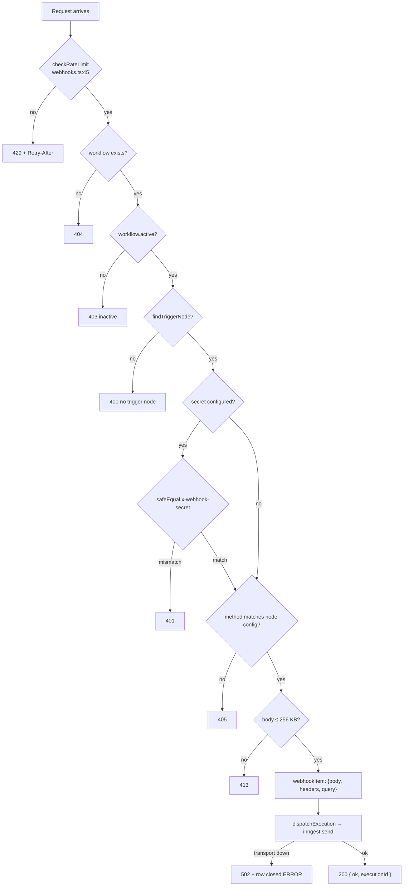

**Realtime vs poll fallback** (client, editor chrome):

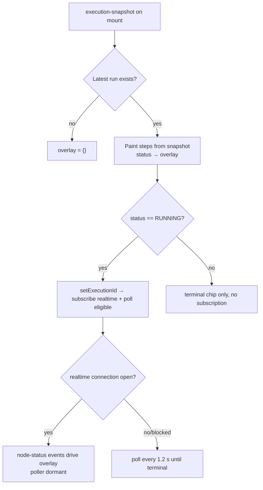

### 8.11 Class-style view of the engine state

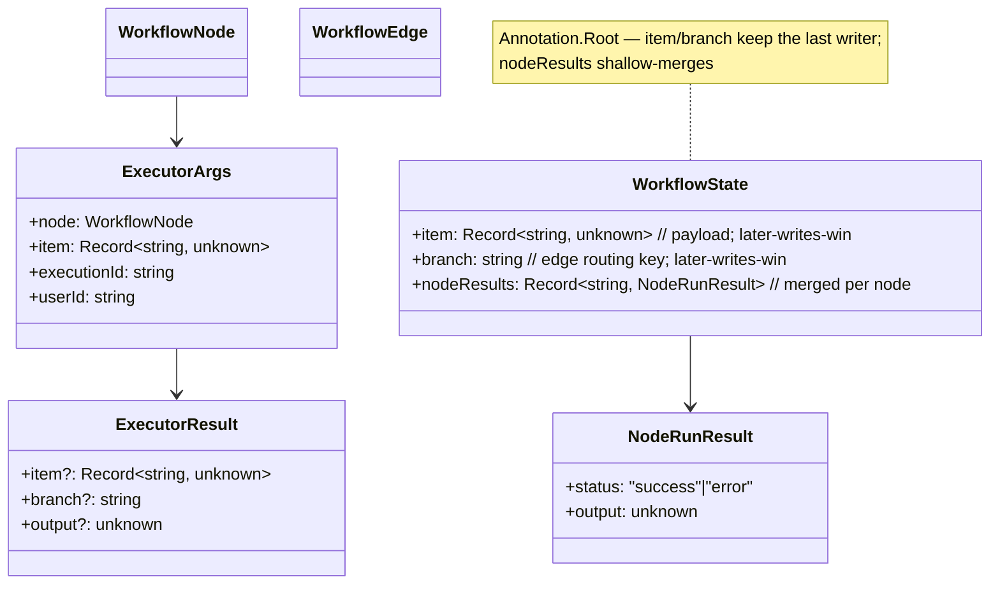

LangGraph merges `nodeResults` across parallel/sequential nodes via `{...prev, ...next}` ([state.ts:13-17](app/modules/engine/lib/state.ts#L13)); `item`/`branch` use `next ?? prev` — so an executor returning a falsy `branch` keeps the previous one (this is what preserves IF routing across intervening nodes).

## 9. Function Connectivity and Dependency Graphs

### 9.1 Engine call graph (verified, not guessed)

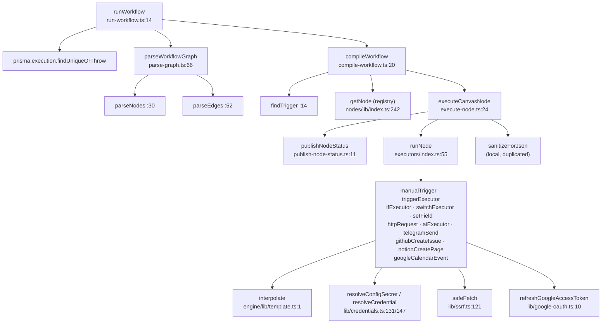

### 9.2 Client → server call graph

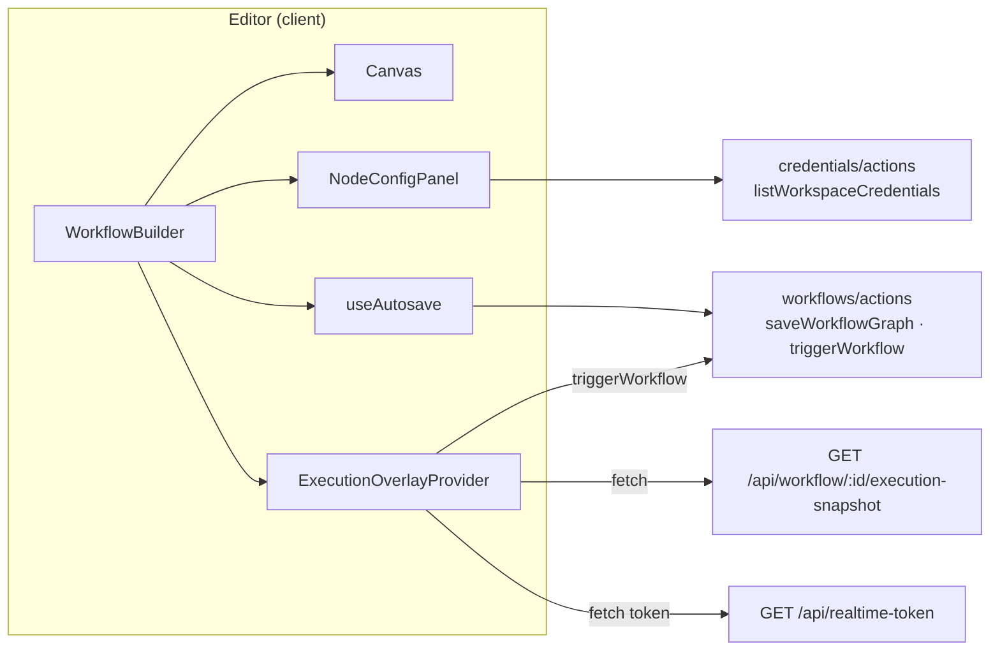

### 9.3 Module dependency matrix (server side)

| Module ↓ depends on → | prisma | engine | nodes | inngest | lib | workflows |
|---|---|---|---|---|---|---|
| `workflows/actions` | ✓ | — | — | via dispatch | redact, auth | ✓ (dispatch) |
| `workflows/lib/dispatch-execution` | ✓ | — | — | ✓ (client, events) | — | — |
| `engine/*` | ✓ | self | `executors/index` | publish-node-status | credentials, ssrf | — |
| `nodes/executors/*` | — | template.ts | index | — | credentials, ssrf, google-oauth | — |
| `api/webhooks/*` | ✓ | — | — | via dispatch | credentials, ssrf? no — webhook lib | webhook lib, dispatch |
| `api/inngest` | — | — | — | ✓ (client, functions, serve) | — | — |

No cycles across modules at the file level. Within a module there are re-exports but no import cycles (engine imports nodes executors; nodes executors import engine `template.ts` — that is a **two-way edge between `engine` and `nodes/executors`**: `nodes/executors/*.ts` import `interpolate` from `app/modules/engine/lib/template.ts`, and `app/modules/engine/lib/execute-node.ts` imports `runNode` from `app/modules/nodes/executors/index.ts`. It is not a cycle at the *file-import* level (template.ts doesn't import executors), but the modules are mutually coupled — §22).

### 9.4 Event/notification graph

```mermaid
flowchart LR
  subgraph producers
    DISP["dispatchExecution"]
    EXN["executeCanvasNode"]
  end
  INN["Inngest<br/>workflow/triggered"]
  RT["Realtime topic<br/>execution:{id} / node-status"]
  EXN -->|publishNodeStatus<br/>(best-effort)| RT
  DISP -->|inngest.send| INN -->|serve → step.run| RUN["runWorkflow"] --> EXN
  RT -->|WSS| SUB["useExecutionRealtime"]
  DB[("ExecutionStep rows")] -->|poll| POL["useExecutionPoll"]
  SUB --> OVERLAY["overlay state"]
  POL --> OVERLAY
  OVERLAY --> NODES["BaseNode ring · Edge flow<br/>builder chips · panel banner"]
```

## 10. Core Execution Lifecycles

### 10.1 Application startup

```mermaid
sequenceDiagram
  participant B as Browser
  participant P as proxy.ts
  participant R as RootLayout
  participant G as root-group-layout
  participant Pg as page-async
  participant DB as Neon Postgres

  B->>P: GET / (no/with cookie)
  Note over P: matcher excludes static assets;<br/>only /, /dashboard… match PROTECTED regex
  alt has session cookie
    P->>R: NextResponse.next() + security headers
  else no cookie on protected path
    P-->>B: 307 → /sign-in?callbackURL=/
  end
  R->>G: ThemeProvider → DOM
  G->>Pg: h-dvh shell, skip link
  Note over Pg: getCurrentUser() → auth.api.getSession(headers())<br/>(wrapped in React cache())
  Pg->>DB: SELECT session/user (cached)
  Pg->>DB: workflows + stats (Promise.all)
  Pg-->>B: streamed RSC payload + Suspense skeleton
```

Details:

- `app/layout.tsx` fonts/metadata run before any page code; `app/(root)/layout.tsx` is deliberately **synchronous** so Cache Components can prerender the shell; the dynamic data lives in pages under `loading.tsx`'s Suspense boundary — see the comment in [app/(root)/layout.tsx:1-6](app/(root)/layout.tsx#L1).
- Pages that depend on the session declare `export const instant = false` ([credentials page:8](app/(root)/credentials/page.tsx#L8), executions pages, templates, workflows/[id]) — they are allowed to block navigation; the home page does not declare it (observed inconsistency, §22).
- The proxy's security headers (`X-Frame-Options: SAMEORIGIN`, `X-Content-Type-Options: nosniff`, `Referrer-Policy`, `X-DNS-Prefetch-Control`) are applied via `applySecurityHeaders` ([proxy.ts:76](proxy.ts#L76)).

### 10.2 Authentication (email/password) and session lifecycle

```mermaid
sequenceDiagram
  participant U as User
  participant F as SigninForm-client
  participant BA as api-auth-sign-in-email<br/>better-auth handler
  participant DB as Postgres
  participant PX as proxy.ts

  U->>F: submit email+password
  F->>F: validate (email present, pw ≥ 8)
  F->>BA: authClient.signIn.email({email, password, callbackURL})
  BA->>DB: verify credential (scrypt hash), create session row
  BA-->>F: 200 + Set-Cookie better-auth.session_token (HttpOnly)
  F->>U: router.push(callbackURL) + "Signed in…"
  Note over PX: next nav: cookie present → passes; pages still<br/>call getCurrentUser() (defense in depth)
```

- **OAuth** (`signIn.social`, or server action `signIn` at [auth/actions:32](app/modules/auth/actions/index.ts#L32) with `disableRedirect: true`): better-auth generates the provider URL; the browser is redirected to GitHub/Google; callback hits `/api/auth/callback/{provider}`; session created; `requireUnAuth` in `/sign-in` would now redirect home.
- **Session transport:** HTTP-only cookie `better-auth.session_token` (or `__Secure-` variant on HTTPS). `session.cookieCache.maxAge = 300` (5 min) means **a revoked session can remain valid up to 5 minutes** against cached-cookie checks ([lib/auth.ts:10-14](lib/auth.ts#L10)) — the source comment acknowledges this trade; the proxy only checks cookie *presence* regardless.
- **Sign-out:** `signOut` action → server deletes session row → six cookies force-deleted ([auth/actions:51-59](app/modules/auth/actions/index.ts#L51)) → `redirect('/sign-in')`. The explicit cookie deletion exists because the proxy would otherwise bounce `/sign-in` → `/` → `/sign-in` in a loop.

### 10.3 Creating a workflow

1. Dialog `NewWorkflowButton` → `createWorkflow(name)` server action ([actions:52](app/modules/workflows/actions/index.ts#L52)).
2. `prisma.workflow.create({ data: { name, userId } })` — `nodes`/`edges` default to `[]`, `active=false`.
3. `revalidatePath("/")` then **`redirect(`/workflows/${id}`)`** — control never returns to the client for a thrown NEXT_REDIRECT; the editor route renders.
4. Editor page: `getWorkflow(id)` → ownership-scoped fetch → `redactValue` on the graph → `<WorkflowEditor><WorkflowBuilder …/>`.
5. Empty canvas → `CanvasEmptyState` → "Add a trigger" button → `addNodeAtCenter("manual-trigger")`.

### 10.4 Editing and autosave

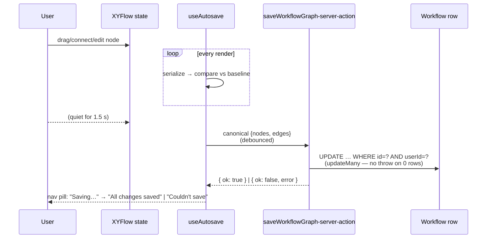

`onStatusChange` flows through `SaveStatusContext` into `SaveIndicator`. If the tab crashes between debounce and server commit, the edit is lost — no `beforeunload` flush exists (§22).

### 10.5 Manual run — end to end (the most important flow in the app)

```mermaid
sequenceDiagram
  participant U as User
  participant B as WorkflowRunButton<br/>workflow-editor.tsx:31
  participant SA as triggerWorkflow-action
  participant DISP as dispatchExecution
  participant DB as Postgres
  participant INN as Inngest
  participant F as executeWorkflow-serve
  participant E as runWorkflow / LangGraph
  participant RT as Realtime

  U->>B: click ▶ "Run workflow"
  B->>SA: startRun(workflowId) → triggerWorkflow(id)
  SA->>DB: findFirst workflow {id, userId}
  SA->>DISP: dispatchExecution(workflowId, "MANUAL")
  DISP->>DB: INSERT Execution(status=RUNNING, trigger=MANUAL, data=input∥null)
  DISP->>INN: inngest.send(workflow/triggered{…})
  alt send fails
    DISP->>DB: UPDATE Execution → ERROR + finishedAt + data.error
    DISP-->>SA: { error } → 502/UI error
  else sent
    DISP-->>SA: { executionId }
    SA-->>B: executionId (redirect/refresh NOT done for manual)
  end
  B->>B: overlay = {}; setExecutionId(id)
  INN->>F: POST /api/inngest (signed)
  F->>E: step.run("run-workflow", () => runWorkflow(executionId))
  E->>DB: execution.findUniqueOrThrow + workflow
  E->>E: parse → compile → invoke(item)
  loop each node
    E->>DB: INSERT ExecutionStep(RUNNING)
    E->>RT: publish node-status{running}
    RT-->>B: WSS event → BaseNode spinner appears
    E->>E: runNode(...)
    E->>DB: UPDATE step → SUCCESS|ERROR + output/error
    E->>RT: publish node-status{success|error}
    RT-->>B: BaseNode ✓/✗, edge turns emerald/red
  end
  E->>DB: UPDATE Execution → SUCCESS|ERROR + finishedAt + data=item
  B-->>U: chips "Running… done n" → terminal chip 5 s
```

Where the run actually starts: **the Inngest function**, not the click. If Inngest is unreachable, no steps exist and the row is closed `ERROR` by `dispatchExecution` — the user sees "Couldn't start the run — is the Inngest dev server running?".

### 10.6 Mid-run refresh and the snapshot adoption path

1. `ExecutionOverlayProvider` mounts → `GET /api/workflow/{id}/execution-snapshot` (no `executionId`) → latest run.
2. Steps come back redacted; overlay painted immediately — finished nodes show ✓/✗ before realtime connects.
3. If latest run `status == "RUNNING"`, `setExecutionId` → `useExecutionRealtime` subscribes (token from `/api/realtime-token`) **and** `useExecutionPoll` becomes eligible (enabled only while realtime not open); poll backs off 2.5 s on errors.
4. Node IO is never in the realtime payload (`output` is published but the overlay only stores `status`/`errorMessage` — the payload's `output` is currently ignored by `applyNodeStatus`); step details are fetched from the snapshot/detail pages.

### 10.7 Webhook-triggered run (GitHub push)

```mermaid
sequenceDiagram
  participant GH as GitHub
  participant WH as /api/webhooks/[workflowId]/github
  participant DB as Postgres
  participant DISP as dispatchExecution → Inngest → Engine
  participant UI as Open-editor-any-session

  GH->>WH: POST push event<br/>x-github-event: push · x-hub-signature-256<br/>(secret from node config)
  WH->>WH: rate-limit 120/min/key(github:WF)
  WH->>DB: workflow.findUnique (no user scoping — public endpoint)
  WH-->>GH: 403 if inactive | 400 if no github-trigger node
  WH->>WH: events config filter (e.g. push only) → 204 otherwise
  WH->>WH: readJsonBody (≤256 KB) · sign256(secret, raw) vs header
  Note over WH: timing-safe compare; mismatch → 401
  WH->>DISP: dispatchExecution(WF, "GITHUB", { ...payload, event, delivery })
  DISP-->>GH: 200 { ok, executionId }
  UI-->>UI: (if viewing that workflow) overlay updates via realtime/poll
```

GitHub accepts 2xx and 204 (filtered) as delivered; anything else triggers retries — so a `403` for inactive workflows will retry from GitHub's side (documented limitation, §22).

### 10.8 Retry of a failed execution

`retryExecution` ([actions:210](app/modules/workflows/actions/index.ts#L210)) finds the execution, re-dispatches with the stored `execution.data` and the original `execution.trigger`, and passes **`execution.id` as the new run's `retryOfId`** — so retries form a first-class linked chain (`Execution.retryOfId`, a self-relation added by migration `20261115210441_add_execution_retry_of`). It is a fresh whole-graph replay, not a resume: all steps re-execute, and the new row records its provenance.

Plumbings added for this: `dispatchExecution` accepts an optional 4th argument `retryOfId` ([dispatch-execution.ts](app/modules/workflows/lib/dispatch-execution.ts)), `getExecutions` selects `retryOfId` for the list, and `getExecution` now also returns `execution.retries` (recent retries, status/startedAt). **As of this analysis the chain is not yet rendered in the Executions UI** — the schema, plumbing and redacted shape are in place; the surface work is pending. Behavioral note that still applies: after a SUCCESS, `execution.data` holds the final payload — retrying a *succeeded* run re-feeds that final item as input (after a failure, `data` is untouched and holds the trigger input). This asymmetry survives the retry-of work.

### 10.9 Template instantiation

`UseTemplateButton` → `createWorkflowFromTemplate(templateId)` ([templates/actions:14](app/modules/templates/actions/index.ts#L14)) → `getTemplate(id)` (static registry) → `prisma.workflow.create` with the template's node/edge JSON → `revalidatePath("/")` → redirect to the editor. No credentials travel; templates carry placeholder config only.

## 11. API and Communication Flows

### 11.1 Route handler inventory

| Route | Methods | Auth model | Purpose |
|---|---|---|---|
| [`/api/auth/[...all]`](app/api/auth/[...all]/route.ts) | GET, POST | none (public by design) | better-auth handler: sign-in/up, OAuth callbacks, session, sign-out |
| [`/api/inngest`](app/api/inngest/route.ts) | GET, POST, PUT | Inngest request signing (prod) / open in dev | Inngest serve endpoint; `maxDuration = 300` (5 min run cap) |
| [`/api/realtime-token`](app/api/realtime-token/route.ts) | GET | session + execution ownership | Mint subscribe-only channel token `execution:{id}`, topic `node-status` |
| [`/api/webhooks/[workflowId]`](app/api/webhooks/[workflowId]/route.ts) | GET, POST, PUT, PATCH, DELETE | per-node secret header (optional) | Generic webhook ingress; n8n-compatible `{body, headers, query}` |
| [`/api/webhooks/[workflowId]/github`](app/api/webhooks/[workflowId]/github/route.ts) | POST | `X-Hub-Signature-256` HMAC (optional) | GitHub events; event-type filter; 204 for unsubscribed events |
| [`/api/webhooks/[workflowId]/telegram`](app/api/webhooks/[workflowId]/telegram/route.ts) | POST | `x-telegram-bot-api-secret-token` (optional) | Telegram updates; extracts `chat_id`/`text` for downstream `{{chat_id}}` |
| [`/api/workflow/[workflowId]/execution-snapshot`](app/api/workflow/[workflowId]/execution-snapshot/route.ts) | GET | session + ownership | Redacted latest/specified execution + steps for the overlay |

**There is no REST CRUD API for workflows.** All dashboard mutations are server actions (better type-safety, no serialization layer); the API surface exists only for machine callers (GitHub/Telegram/OpenAI-compatible) and realtime.

### 11.2 Auth matrix

| Caller | Path | Credential |
|---|---|---|
| Browser user | Server actions | session cookie; `requireAuth()` inside each |
| Browser user | `/api/realtime-token`, `execution-snapshot` | session cookie; ownership check |
| GitHub | `/api/webhooks/[id]/github` | `X-Hub-Signature-256: sha256=` HMAC-SHA256 of raw body |
| Telegram | `/api/webhooks/[id]/telegram` | `x-telegram-bot-api-secret-token` header, timing-safe compare |
| Any HTTP client | `/api/webhooks/[id]` | optional `x-webhook-secret` header |
| Inngest platform | `/api/inngest` | signed request verification (signing key) in prod |
| Stripe-like future callers | `/api/webhooks/[id]` | same as generic |

### 11.3 Realtime wire protocol

- Channel: `execution:{executionId}` ([channels.ts:4-18](app/modules/inngest/realtime/channels.ts#L4))
- Topic: `node-status` with static schema `{ nodeId: string; status: "running"|"success"|"error"; output?: unknown; error?: string }`.
- Publisher: `publishNodeStatus` — wraps `inngest.realtime.publish(channel["node-status"], payload)` in try/catch (best-effort).
- Subscriber: `useRealtime` → delta messages; `applyNodeStatus` merges into overlay; error messages preserved.

### 11.4 Request lifecycle — POST webhook to finished run (all layers)

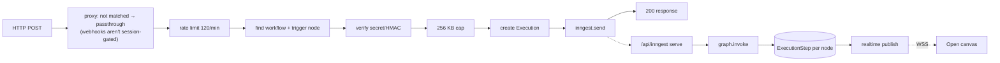

## 12. Database Architecture and Data Relationships

### 12.1 ER diagram (Prisma schema: [prisma/schema.prisma](prisma/schema.prisma))

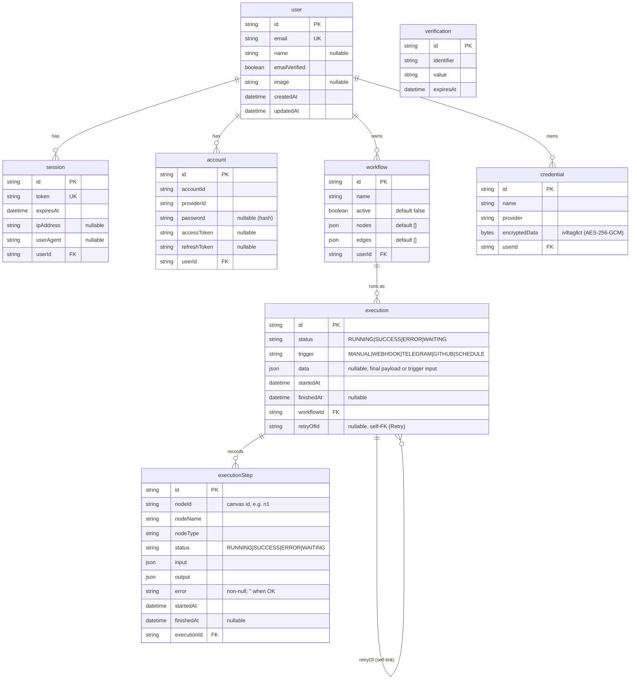

### 12.2 Table-by-table notes

- **`user` / `session` / `account` / `verification`** — better-auth tables with lowercase `@@map`. `account.password` stores the better-auth hash (scrypt) for the email/password provider. Session tokens unique-indexed; session cascades on user delete.
- **`workflow`** — the graph *is* the row: `nodes`/`edges` JSONB with `[]` defaults. `@@index([userId, updatedAt(sort: Desc)])` serves the dashboard sort; `@@index([userId])` serves isolation checks. No optimistic-concurrency column — autosave is last-write-wins (§22).
- **`execution`** — denormalized run record. `data` starts as the trigger payload (set at dispatch) and is **overwritten** with the final payload at completion ([run-workflow.ts:29-36](app/modules/engine/lib/run-workflow.ts#L29)) — the original input is only recoverable if the final item equals it or via retry history. Indexes: `[workflowId]`, `[workflowId, startedAt Desc]` (added by `20261114000002_add_workflow_indexes`).
- **`executionStep`** — per-node IO. `input` is the payload *as seen by the node* (full item, pre-node), `output` the node's `output` (falls back to `item`). `error` is `TEXT NOT NULL` — empty string means OK; truncated to 1000 chars on failure.
- **`credential`** — single blob `encryptedData` (`iv‖tag‖ct`), never selected into the UI; provider is a free string (registry: `openrouter|openai|anthropic|google|github|notion|telegram|custom`).

### 12.3 Migrations (5)

| Migration | Contents |
|---|---|
| `20261114000000_baseline` | `user`, `session`, `account`, `verification` + indexes/FKs |
| `20261114000001_add_workflow_models` | `ExecutionStatus`/`TriggerType` enums; `Workflow`, `Execution`, `ExecutionStep` + FKs |
| `20261114000002_add_workflow_indexes` | Composite `userId+updatedAt`, `workflowId+startedAt` indexes (re-created replacement for a deleted `20261113231927_add_workflow_indexes` — see §21) |
| `20261115115752_add_credentials` | `credential` table (`BYTEA encryptedData`) |
| `20261115210441_add_execution_retry_of` | `Execution.retryOfId` TEXT + self-FK `Execution_retryOfId_fkey` (ON DELETE SET NULL) |

Prisma 7 doesn't use `url = env(...)` in the datasource block; connection comes from the **driver adapter** (`@prisma/adapter-pg`) at runtime and from `datasource.url` in [prisma.config.ts](prisma.config.ts) for CLI. `DIRECT_URL` falls back to `DATABASE_URL` — on pooled Neon, prefer setting `DIRECT_URL` (migrations through pgBouncer cause advisory-lock pain — [Doc] comment in prisma.config.ts).

### 12.4 Why JSON-in-Postgres instead of a node/edge table

**[Impl, likely deliberate]** — the graph is edited as a unit, loaded as a unit, autosaved as a unit; querying *inside* the graph is never needed except `findTriggerNode` (a linear scan in JS, acceptable at 13 node types and small graphs). A normalized `workflow_node` table would buy integrity constraints but cost a join on every page load and every run, for zero observed query benefit. Trade-off: **no DB-level integrity on graph shape** — corrupt JSON, unreachable edges, duplicate ids are all possible; the engine mitigates with strict parse + LangGraph compile errors → `ERROR` status, not corruption.

## 13. State Management and Data Flow

CoralFrame uses **four** distinct state systems, deliberately kept disjoint:

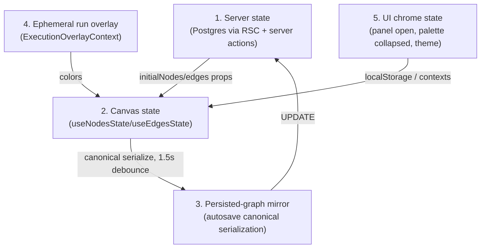

1. **Server state** — the source of truth. Pages fetch via `prisma` (RSC) or server actions; redaction applied at the boundary; `revalidatePath` controls freshness after mutations (used by rename/toggle/create/delete; **not used by autosave** — the editor keeps its own client state).
2. **Canvas state** — XYFlow's `useNodesState`/`useEdgesState`. Ephemeral interaction fields (`selected`, `dragging`, `measured`) live here and never persist (strip on serialize/parse).
3. **Autosave mirror** — refs `serialized`/`serializedEdges` hold the last-known-server JSON; the diff gate is `!==` on strings. This is the entire consistency mechanism between #1 and #2: no CRDT, no versioning, no conflict detection — last tab to save wins.
4. **Execution overlay** — `useState` in `ExecutionOverlayProvider`, Context-distributed. Written by realtime handler and poller; read by nodes/edges/panel/builder-chips. **Never persisted** (by design: it'd thrash autosave, and it's reconstructible from `ExecutionStep`).
5. **Chrome** — `useSyncExternalStore` for palette collapse (localStorage, custom event + `storage` listener for cross-tab), `next-themes` for theme, plain `useState` elsewhere.

**Cross-boundary rules enforced by code:** server → client data passes only through redacting selects; client → server only through typed server actions (`saveWorkflowGraph` accepts `unknown[]` but doesn't trust it — it persists after client-side canonicalization and server-side JSONB cast; ownership re-checked server-side).

## 14. Authentication and Security Architecture

### 14.1 Identity stack

```mermaid
flowchart LR
  U[User] --> CF[Sign-in UI]
  CF -->|HTTPS| APP[better-auth<br/>/api/auth/*]
  APP -->|adapter| PR[("Postgres<br/>user/session/account/verification")]
  subgraph Security layers, outermost first
    PX["1. proxy.ts<br/>cookie presence + security headers"]
    RSC["2. Pages<br/>getCurrentUser() / requireAuth()"]
    SA["3. Server actions<br/>requireAuth() + ownership-scoped queries"]
    DB["4. Prisma queries<br/>{ id, userId } predicates"]
    RED["5. Redaction<br/>redactValue before client serialization"]
  end
```

**better-auth** ([lib/auth.ts](lib/auth.ts)):

- `emailAndPassword: { enabled: true }` — works out of the box (scrypt hashing, email verification **not required** by default; `emailVerified` stored but not enforced anywhere in this codebase).
- `socialProviders.github/google` — **placeholder fallbacks when env vars are missing** (`"github_client_id_placeholder"`), so `/api/auth` never crashes at init; the OAuth dance itself then fails at the provider. Email/password always works.
- `session.cookieCache: { enabled: true, maxAge: 300 }` — session payload cached client-side in a signed cookie for 5 min; revocation latency up to 5 min. [Doc] the source comment says exactly this.
- Sessions are DB rows (not JWT-only) — revocation is a row delete; `signOut` also force-clears six cookie names including `__Secure-` variants.

### 14.2 Layer-by-layer behavior

**Layer 1 — `proxy.ts` ([measured])** — the Next.js 16 Proxy. What it *intends* (per its regexes) vs what it *does*:

| Path | Intended | Actual (verified by executing the regex) |
|---|---|---|
| `/` | protected | **protected** (exact match) |
| `/dashboard…`, `/settings…`, `/profile…`, `/admin…` | protected | protected (these routes don't exist in the app) |
| `/sign-in` (+ sign-up, forgot/reset) | redirect-if-authed | works |
| `/api/auth/*` | public | public |
| `/api/webhooks/*`, `/api/inngest`, `/api/realtime-token`, `/api/workflow/*` | matched by `api\/(?!auth)` branch → protected | **NOT matched** — the branch requires a further `$` or `/` after `api/`, which no real API path satisfies (verified: all return false) |
| `/credentials`, `/executions`, `/templates`, `/workflows/[id]` | — (not in any regex) | **NOT matched — public at this layer** |

So the proxy protects only `/`. Every other protected page still enforces auth **server-side** via `getCurrentUser()` + `redirect("/sign-in")` in the page body (all `(root)` pages do this; the workflow editor does so via `getWorkflow` → `requireAuth`). API routes each check `getCurrentUser()` themselves (401 JSON). **The application is not broken — but the proxy is doing far less than its comments imply.** [Impl, verified by executing the regexes — see Appendix B].

**Layer 2 — Pages:** every `(root)` page starts with `getCurrentUser()`; false → `redirect("/sign-in")`. The `(auth)/sign-in` page inverse-gates via `requireUnAuth` and sanitizes `callbackURL` to same-origin paths ([sign-in/page.tsx — `safeCallbackURL`](app/(auth)/sign-in/page.tsx)).

**Layer 3 — Server actions:** `requireAuth()` at handler entry; **ownership predicates in the query itself** (`where: { id, userId }`) rather than post-hoc checks — a foreign id simply yields `null`/zero rows. `updateMany`+`deleteMany` patterns everywhere (never `update({ where: { id } })` without `userId`).

**Layer 4 — Webhook ingress:** unauthenticated *by design*; trust comes from (a) per-workflow in-memory rate limit (120/min; single-instance only), (b) optional per-node secret, (c) HMAC verification for GitHub (`X-Hub-Signature-256`, timing-safe), (d) Telegram secret-token compare, (e) 256 KB body cap, (f) `active`-workflow gate, (g) secret-stripping header whitelist before persistence.

**Layer 5 — Redaction at egress:** `redactValue` applied in `getWorkflows`, `getWorkflow`, `getExecution(s)`, snapshot route, execution detail rendering. Input/output shown in the UI never contains secret-typed keys/values in clear.

### 14.3 Credential vault

Covered in §8.5. Additional properties:

- Ownership enforced at `resolveCredential` — one workspace cannot spend another's credential.
- Ciphertext blob is opaque (`Bytes`); swapping envelopes between rows fails GCM verify (authentication tag mismatch) — test asserts round-trip tamper failure ([lib/credentials.test.ts](lib/credentials.test.ts)).
- The vault has **no rotate/re-encrypt-all function** — key rotation = manual (documented as limitation; re-encrypt per credential via update).
- `CREDENTIALS_ENCRYPTION_KEY` **is** in `.env.example` (with the `openssl rand -hex 32` hint) and is called out by the README's "Security & credentials" section. One gap: `.env.example` omits `GOOGLE_REFRESH_TOKEN` and the `INNGEST_*` keys — see §19/§22.7.

### 14.4 SSRF and outbound requests

Only **user-defined URLs** pass through the SSRF guard (the `http-request` node). Fixed integration endpoints (Telegram, GitHub, Notion, Google, OpenRouter, Google OAuth) use plain `fetch` — their destinations are constants, not user input, so SSRF doesn't apply. Consequences: an attacker who can change the constant… can't (server-side code). The one dynamic URL in plain fetch is the Google Calendar `calendarId` (path-segment encoded via `encodeURIComponent`) — safe from path injection.

### 14.5 Security headers

Proxy applies to *matched* responses only: `X-Frame-Options: SAMEORIGIN`, `X-Content-Type-Options: nosniff`, `Referrer-Policy: strict-origin-when-cross-origin`, `X-DNS-Prefetch-Control: on`. Next.js itself sets `X-Powered-By` removal? (Not configured — `poweredByHeader` default is on; minor.) CSP is **not** set anywhere (see §22).

### 14.6 What is NOT protected (explicit)

- `.env` handling is manual (gitignored, `.env.bak` sits in working dir untracked).
- Rate limiter is per-process; serverless/multi-instance deployments get per-instance buckets (120/min × N instances effective).
- No CSRF token machinery is needed for server actions (Next Origin-check + SameSite cookies); webhook endpoints are POST-from-third-parties by design and rely on HMAC/secrets, not cookies.
- `useOptimistic` toggles activation before server confirmation — a failed toggle shows an error but the switch reverts only on re-render with server state (acceptable UX trade).
- Availability of `generateStaticParams`-style caching could leak? No caching of authed pages is configured (`instant=false`, dynamic).

## 15. Background Jobs and Event Processing

### 15.1 Inngest topology

```mermaid
sequenceDiagram
  participant App as Next.js process
  participant INN as Inngest-cloud-dev
  participant F as executeWorkflow

  App->>INN: PUT/GET/POST /api/inngest (serve)
  INN->>F: invoke fn "execute-workflow"<br/>event workflow/triggered
  F->>F: step.run("run-workflow", …)
  F-->>INN: { ok, workflowId, executionId }
```

- **Client:** [app/modules/inngest/client.ts](app/modules/inngest/client.ts) `new Inngest({ id: "coralframe" })`.
- **Function:** [functions/execute-workflow.ts](app/modules/inngest/functions/execute-workflow.ts#L5) — triggers on `workflow/triggered`; the whole `runWorkflow` is one `step.run` so Inngest memoizes it — **a retry of the step re-executes the entire workflow, creating a duplicate set of `ExecutionStep` rows** (steps are not keyed by Inngest step ids). See §22 — biggest correctness wart in the async layer.
- **Serve:** [api/inngest/route.ts](app/api/inngest/route.ts#L6) — `maxDuration = 300`; Vercel/Node long-limit dependency.
- **Dev:** requires `inngest-cli dev` (dependency present); failure mode is handled (dispatch marks ERROR).

### 15.2 Realtime as a job side-channel

Publisher: `executeCanvasNode` → `publishNodeStatus` → `inngest.realtime.publish(executionChannel(executionId)["node-status"], …)`.

- Not awaited semantically — `await`ed in code, but errors are swallowed to `console.warn` ([publish-node-status.ts:16-19](app/modules/inngest/realtime/publish-node-status.ts#L16)) so a realtime outage never fails a run.
- Channel name embeds the execution id — **unguessable** (cuid), and token minting is ownership-checked, so cross-workspace snooping is blocked at the token endpoint.
- `output` is sent over realtime but **dropped by the client** (`applyNodeStatus` reads only `status`/`error`) — a conscious size/privacy choice (output may contain secrets pre-redaction!). Detail pages fetch outputs via the redacting snapshot route instead.

### 15.3 No other background processing exists

No cron/scheduled sweep, no outbox, no queue for webhook retries (GitHub retries on non-2xx at its own layer), and `SCHEDULE` trigger type is **unimplemented** (enum reserved; no node type, executor, or dispatcher).

### 15.4 Failure & retry semantics

| Failure point | Behavior |
|---|---|
| `inngest.send` throws (dev server down / bad keys) | Execution row → `ERROR`, explanatory `data.error`; caller gets `{error}` → 502 (webhook) / thrown message (UI) |
| Inngest function throws (compile error, node exception) | `step.run` fails → `runWorkflow` catch → Execution `ERROR` + finishedAt; Inngest may retry the *function* (config: none specified — Inngest default retry policy applies; each retry re-runs all steps) |
| Step DB write fails mid-run | `executeCanvasNode` catch → tries to mark step ERROR (may itself fail) → run aborts → Execution ERROR |
| Realtime publish fails | swallowed; poller + snapshot still render truth |

## 16. External Integrations

### 16.1 Integration matrix

| Integration | Entry point | Auth | Direction | Failure semantics |
|---|---|---|---|---|
| **OpenRouter / OpenAI / Anthropic / Google** (LLM) | [ai.ts](app/modules/nodes/executors/ai.ts) via LangChain | API key: credential → inline → env | outbound | Step error w/ provider message; run → ERROR |
| **OpenRouter catalogue** | [catalogue.ts](app/modules/openrouter/lib/catalogue.ts) | none (public endpoint) | outbound | 5 min cache → stale-on-error → else error UI |
| **Telegram Bot API** | [telegram-send.ts](app/modules/nodes/executors/telegram-send.ts), [telegram webhook](app/api/webhooks/[workflowId]/telegram/route.ts) | bot token; webhook `x-telegram-bot-api-secret-token` | both | Send: throw on non-OK. Hook: 401/403/429/502 |
| **GitHub** | [github-create-issue.ts](app/modules/nodes/executors/github-create-issue.ts), [github webhook](app/api/webhooks/[workflowId]/github/route.ts) | token / `X-Hub-Signature-256` | both | Verify → 401; filter → 204; else dispatch |
| **Notion** | [notion-create-page.ts](app/modules/nodes/executors/notion-create-page.ts) | integration token `secret_…` | outbound | Step error w/ Notion message |
| **Google Calendar** | [google-calendar-event.ts](app/modules/nodes/executors/google-calendar-event.ts), [google-oauth.ts](lib/google-oauth.ts) | access token, or refresh-token exchange (`GOOGLE_REFRESH_TOKEN`) | outbound | Token exchange failure → step error |
| **Inngest** | [api/inngest](app/api/inngest/route.ts), [client](app/modules/inngest/client.ts) | dev: open; prod: signing key | both | Dispatch-time failure handled (§15.4); function failures surface in Inngest dashboard |
| **Neon Postgres** | [lib/prisma.ts](lib/prisma.ts) | `DATABASE_URL` / `DIRECT_URL` | — | Any DB error → page error boundary / action `{ok:false}` / run ERROR |

### 16.2 Credential → integration mapping

| Integration | Field read from credential payload | Fallback |
|---|---|---|
| OpenRouter / OpenAI / Anthropic / Google | `apiKey` (fallback `token`/`password`/`secret`) | env `OPENROUTER_API_KEY` / `OPENAI_API_KEY` / `ANTHROPIC_API_KEY` / `GOOGLE_API_KEY` |
| Telegram send | `botToken` | inline node config |
| GitHub create issue | `token` | inline node config |
| Notion | `token` | inline node config |
| Google Calendar | `token` | env `GOOGLE_REFRESH_TOKEN` + client pair |
| Generic webhook / GitHub / Telegram triggers | `secret` | inline node config |

### 16.3 Telegram specifics

The webhook route flattens `message ?? edited_message ?? channel_post ?? edited_channel_post ?? callback_query` into `{...update, message, chat_id, text}` — this is what makes `{{chat_id}}` and `{{text}}` work in the Telegram Send node after a Telegram trigger without extra mapping steps. `callback_query.data` is mapped to `text` so button presses behave like messages.

### 16.4 Credential validation endpoints (new, unwired)

`lib/credential-validation.ts` (server action `testCredential`) validates stored credentials against the lightest official read endpoint per provider — GitHub `GET /user`, Notion `GET /v1/users/me`, Telegram `getMe`, OpenRouter `GET /credits`, OpenAI `GET /models`, Anthropic `GET /v1/models` (with `anthropic-version: 2023-06-01`), Google `models?key=`, and Google Calendar (exchange refresh token, then `calendarList` read). Owner-scoped, decrypts server-side, returns only ok/error text — no secret values ever leave the server. **No caller exists yet**; the credentials UI has no "Test" button in this snapshot.

### 16.5 GitHub specifics

Event filter (`config.events`, comma-separated, default empty = all) runs *before* signature verification? — No: **after** workflow/trigger-node checks but **before** body read? — Precisely: after `x-github-event` presence check and before reading the body ([github/route.ts:23-31](app/api/webhooks/[workflowId]/github/route.ts#L23)) — unsubscribed events get **204** (ack, no run) and never touch the signature/body machinery. Signature is verified on the **raw body** read with a 256 KB cap.

## 17. Architectural Decisions and Trade-offs

Each entry: approach **(A)** · what it solves **(P)** · evidence **[tags]** · alternatives **(Alt)** · trade-offs **(T)**.

**D1 — Workflow graphs as JSONB in Postgres, not a normalized node table.**
(P) One-unit load/save; schema-free evolution of node configs; cheap autosave. (A) [Impl] `Workflow.nodes/edges Json`. (Alt) `workflow_node`/`workflow_edge` tables; document store; dedicated graph DB. (T) No DB-enforced integrity, no partial updates, no cross-graph queries; `findTriggerNode` is a JS scan per webhook. Right call for an editor whose primary operation is whole-graph read/write at human edit speed. Parse-time validation (`parseNodes` drops bad entries) is the compensating control.

**D2 — LangGraph at execution time, not a custom walker.**
(P) Conditional edges (IF/Switch) with battle-tested semantics; reducer channels give last-write-wins `item`/`branch` semantics for free. (A) [Impl] `StateGraph` in compile-workflow. (Alt) Topological walker with explicit stack; n8n-style hand-rolled runner; Temporal workflows. (T) `@langchain/langgraph` is heavyweight on the serverless cold path; step rows are not idempotent across retries (§22); LangGraph error surfaces (thrown `Error`) are opaque to users except via `ExecutionStep.error`. No parallelism yet — sequential `.invoke` only, despite LangGraph's super-step model (nodes here are wired linearly/conditionally; LangGraph could run independent branches concurrently but the wiring doesn't exploit it).

**D3 — Inngest for background execution + Realtime for telemetry, DB as truth.**
(P) Durable invoke, signed serve endpoint, and a managed pub/sub — no bespoke socket server; client gets best-effort liveness without correctness risk. (A) [Doc] comments: "Realtime is best-effort telemetry — polling and DB are the source of truth" ([publish-node-status.ts](app/modules/inngest/realtime/publish-node-status.ts)). (Alt) WS gateway (e.g. custom Socket.IO), SSE route per run, pure polling. (T) Two transports to reason about; realtime adds an Inngest account dependency; poll fallback doubles the snapshot route's importance (hence its ownership check + redaction).

**D4 — Redact at the server boundary, never "trust the client".**
(P) Node configs may contain live API tokens; UI must see a runnable graph minus secrets. (A) [Doc+Impl] `redactValue` everywhere graphs exit; `redactGraph` unused because inlining was simpler. (T) Redaction is key/value *pattern* matching — a secret stored under a non-matching key (e.g. `config.foo = "ghp_…"`) is caught by value; a secret under `config.note = "hunter2"` is not. Depth cap 12 can truncate exotic graphs. False positives possible (`"token"` as a *label*, e.g. field named `tokenize`).

**D5 — One `NodeType` registry consumed by palette, canvas, inspector and (implicitly) executors.**
(P) "What steps exist" defined exactly once; adding a step = registry entry + executor + (optional) UI tweaks. (A) [Impl] `app/modules/nodes/lib/index.ts` + `app/modules/nodes/executors/index.ts`; comment: "Unknown node types fail with an actionable error". (T) Three maps to keep in sync (registry, executor dispatch, icon tiles/brand) — drift shows up as runtime "No executor for node type". Registry `switch` outputs say `[{id:"default"}]` while the canvas renders per-case handles dynamically — two sources of truth for Switch handles ([base-node.tsx:49-62](app/modules/canvas/components/nodes/base-node.tsx#L49) vs registry) — inconsistent but functional because the canvas — not the registry — renders handles. Documented here because it confused readers during analysis.

**D6 — better-auth with DB sessions + 5-minute cookie cache.**
(P) Revocable sessions without JWT blindness; cheap nav-time checks. (A) [Doc] `session.cookieCache.maxAge` comment (revocation lag). (T) Revocation lag ≤ 5 min; DB read per uncached request; sign-out needs manual cookie sweep (implemented, [auth/actions:51-59](app/modules/auth/actions/index.ts#L51)).

**D7 — Proxy exists but is nearly vestigial; auth enforced at data layer.**
(P) Next 16 pushes auth into the data layer (its own docs recommend not relying on proxy alone); pages/actions already call `requireAuth`. (A) [Impl] measured regexes — see §14.2. (T) The proxy *looks* authoritative but isn't — a reader auditing "where is the auth boundary" must land on server actions, not `proxy.ts`. Keeping it is harmless (headers + `/` gate + `/sign-in` bounce); fixing or deleting it is a §22 item.

**D8 — §23-driven persistent secrets beside the graph (`credentialId`) instead of inside it.**
(P) AES-256-GCM at rest; rotation without rewriting graphs; one vault for all providers. (A) [Doc] README "Security & credentials" + code comments. (T) Migration burden — raw inline secrets remain executable (by design, backward compat); the redactor hides them but the DB still holds them; only rotation actually purges them.

**D9 — Rate limiting per-process, in-memory, fixed window.**
(P) Zero-dependency abuse damping on webhook ingress. (A) [Impl] `checkRateLimit` Map of arrays. (T) Not shared across instances; unbounded `Map` growth across distinct workflow ids; no cleanup of idle buckets beyond window trimming.

**D10 — Autosave diff on canonical serialization strings.**
(P) XYFlow mutates node objects constantly (selection/drag); persisting live state would write noise every frame. (A) [Doc] long comment in use-autosave. (T) O(n) stringify per render cycle on large graphs (memo isn't used — each relevant render re-serializes everything; fine at palette scale, quadratic-ish at 100+ nodes); 1.5 s debounce loses work on tab crash; no `beforeunload` flush.

**D11 — Live overlay as separate context, never part of the graph.**
(P) Run telemetry must not trigger autosave or pollute persistence; nodes merge `overlay[id]` with `data.status` at render. (A) [Doc] execution-context comment: "The overlay is ephemeral context — it never reaches the persisted graph, so autosave stays quiet while a run is live." (T) Two sources of status (`data.status` legacy vs overlay) — nodes prefer overlay, fall back to `data.status`; `data.status` is never cleared on the server, so a stale `"error"` could render if overlay is empty and the node ran with an older failure (actually `parseNodes` preserves whatever `status` was persisted — inspect: `status: node.data?.status as …` — yes, persisted statuses are kept; relying on overlay is what makes current status correct).

**D12 — All graph mutations are server actions; APIs only for machines.**
(P) Type-safe mutations with no hand-written fetch layer; revalidation hooks. (T) Server actions aren't directly callable by external scripts/CI without the action protocol; bulk operations (rename 50 workflows) have no API by design.

**D13 — Redaction-then-persist for webhook headers.**
(P) Secret-looking headers never touch Postgres. (A) [Doc] `headerMap` comment "Secrets are stripped". (Impl) §11. (T) Signature headers are dropped even when they'd be useful for debugging — by design.

**D14 — Single-flight engine: `app.invoke` once per run, sequential steps.**
(P) Deterministic debugging; per-step DB rows make post-mortems trivial. (T) No fan-out concurrency within a run (LangGraph could); latency bound = Σ node latencies; long AI calls hold the function (maxDuration 300).

**D15 — `instant = false` opt-outs instead of disabling Cache Components.**
(P) Keep prerendered shells for navigations, exempt only session-dependent pages — [Doc] comment in (root)/layout and `instant` docs. (T) The home page missed the opt-out (§22); CI-time validation would catch drift (framework has level `'warning'` only today).

**Architectural reading — what kind of system this is:** CoralFrame is an *interpreter*, not a compiler. Its correctness invariants live in three places: the parse layer (drops garbage), the executor contracts (`ExecutorResult`), and the DB constraint set (FKs + enums). Everything else is convention. That's an appropriate architecture for a product whose graph language is growing a node type at a time.

## 18. Error Handling and Failure Scenarios

### 18.1 Error propagation map

```mermaid
flowchart TD
  subgraph Node executor throws
    E1["step marked ERROR<br/>message ≤ 1000 chars"] --> E2[publish node-status error]
    E2 --> E3[LangGraph aborts<br/>throw propagates]
    E3 --> E4["runWorkflow catch:<br/>Execution → ERROR + finishedAt<br/>rethrown to Inngest"]
  end
  E4 --> E5{Inngest retry?}
  E5 -->|yes| E6[Whole run re-executes<br/>DUPLICATE step rows]
  E5 -->|no/gives up| E7[Execution remains ERROR]
```

### 18.2 Failure table

| Scenario | Detection | User-facing result | Recovery |
|---|---|---|---|
| Inngest dev server down; `.env` missing signing keys | `inngest.send` rejects | "Couldn't start the run — is the Inngest dev server running?" | Start dev server / set keys |
| Webhook for unknown workflow id | `findUnique` → null | 404 JSON | Verify URL / workflow id |
| Webhook for inactive workflow | `workflow.active == false` | 403 JSON | Activate workflow |
| Webhook HMAC/secret mismatch | timingSafeEqual false | 401 JSON | Re-copy secret |
| Body > 256 KB | `readJsonBody` | 413 JSON | Reduce payload |
| Rate limit exceeded | bucket ≥ 120 | 429 + `Retry-After` | Wait 60 s |
| Node config invalid (empty condition, bad JSON, missing URL) | executor throws | step ERROR with actionable message; run ERROR | Fix node, retry |
| Credential missing / not owned | `resolveCredential` throw | step ERROR "Credential not found for this workspace" | Add credential |
| LLM provider outage / bad key | LangChain invoke throws | step ERROR "AI (provider/model): …" | Fix key/provider |
| Target URL private/metadata (SSRF) | `checkUrlSafety` deny | step ERROR with reason | Use public URL |
| Non-2xx from target API | executor checks `response.ok` | step ERROR w/ body excerpt | Fix upstream |
| JSON-write of binary junk | `sanitizeForJson` pre-strip | (prevented — sanitized pre-write) | — |
| Postgres down | Prisma throw | page error boundary / action `{ok:false}` / run ERROR | Restart DB |
| Refresh token expired (Google) | exchange returns non-OK | step ERROR "Google token refresh failed" | Re-mint refresh token |
| Save graph fails (DB down) | action catch | nav pill "Couldn't save" | Retry on next edit |

### 18.3 Failure philosophy

[Inf] The codebase treats **errors as data at the boundary**: error text is truncated, redacted on read, persisted on the step, and surfaced in four places (step banner, node tooltip, execution pages, action results). It treats **errors as exceptional in the engine**: a throwing node fails the run — there is no `continueOnFail` node setting (unlike n8n), so one bad node aborts everything downstream. Branch nodes route on *values*, not on *errors*. This is simpler and more debuggable; the cost is that bulk workflows can't tolerate partial failure.

### 18.4 Not caught (bypasses)

- `publishNodeStatus` — swallowed by design.
- `JSON.stringify` of cyclic objects in `sanitizeForJson` — would throw inside it; the executors produce plain objects, so cycles are theoretical (a cycle from an LLM response? provider SDKs return plain JSON; safe enough to note).
- `crypto.randomUUID` in `createWorkflowNode`/`edge-types` — unavailable only in non-secure contexts/ancient browsers; acceptable.
- OAuth `signIn` action failure (`auth.api.signInSocial` throws) — propagates to the form's catch → error message shown.

## 19. Important Configuration and Environment Variables

**Never commit these.** `.env*` is gitignored (`.gitignore`). `.env.example` documents the intended set; the code reads a few **extra** ones — marked ⚠️ as gaps.

| Variable | Where read | Required? | Notes |
|---|---|---|---|
| `DATABASE_URL` | [lib/prisma.ts:5](lib/prisma.ts#L5) | yes | Pooled endpoint (Neon pooler) at runtime |
| `DIRECT_URL` | [prisma.config.ts](prisma.config.ts) / `prisma7.config.ts` | migrations | Unpooled; `?? DATABASE_URL` fallback |
| `BETTER_AUTH_SECRET` | better-auth | yes | Session signing; rotation invalidates sessions |
| `BETTER_AUTH_URL` | auth-client, better-auth | yes | `http://localhost:3000` in dev |
| `GITHUB_CLIENT_ID` / `GITHUB_CLIENT_SECRET` | [lib/auth.ts:16-20](lib/auth.ts#L16) | optional | Placeholder fallback allows boot without GitHub OAuth |
| `GOOGLE_CLIENT_ID` / `GOOGLE_CLIENT_SECRET` | [lib/auth.ts:21-25](lib/auth.ts#L21), [google-oauth.ts](lib/google-oauth.ts) | optional / for Calendar | Same pair reused for refresh-token exchange |
| `OPENROUTER_API_KEY` | [ai.ts:24](app/modules/nodes/executors/ai.ts#L24) | ≥1 LLM key | Also env fallback for OpenRouter provider |
| `OPENAI_API_KEY` | [ai.ts:22](app/modules/nodes/executors/ai.ts#L22) | optional | env fallback |
| `ANTHROPIC_API_KEY` | [ai.ts:23](app/modules/nodes/executors/ai.ts#L23) | optional | env fallback |
| `GOOGLE_API_KEY` | [ai.ts:25](app/modules/nodes/executors/ai.ts#L25) | optional | env fallback |
| `CREDENTIALS_ENCRYPTION_KEY` | [lib/credentials.ts:21](lib/credentials.ts#L21) | for vault | 64-hex (`openssl rand -hex 32`) or 32-byte base64 or passphrase (sha256'd) |
| `GOOGLE_REFRESH_TOKEN` | [google-calendar-event.ts:30](app/modules/nodes/executors/google-calendar-event.ts#L30) | optional | ⚠️ **not in .env.example**; enables env-level Calendar access without a credential |
| `INNGEST_DEV` | (local `.env`) | dev | ⚠️ not in `.env.example`; dev-server wiring expected by docs |
| `INNGEST_EVENT_KEY` / `INNGEST_SIGNING_KEY` | inngest sdk | prod | ⚠️ **absent from .env.example** — deployments must discover these from Inngest docs |

`NODE_ENV` — gates the prisma singleton caching (dev only). `NEXT_PUBLIC_APP_URL` — auth-client baseURL fallback.

**Hard-coded constants worth knowing:** webhook body cap 256 KB (`webhook.ts:17`), rate limit 120/min (`webhook.ts:43`), snapshot poll 1.2 s/2.5 s backoff (`use-execution-poll.ts`), autosave 1.5 s (`use-autosave.ts`), save indicator, `maxDuration = 300` (inngest route), OpenRouter catalogue TTL 5 min (`catalogue.ts:33`), cookie cache 300 s (`lib/auth.ts:12`), credit `execution-snapshot` `limit=30` executions (`getExecutions`).

**Missing from `.env.example` (gaps):** `GOOGLE_REFRESH_TOKEN`, `INNGEST_*`, `NEXT_PUBLIC_APP_URL`. Present but unused by code: **none observed** (all example vars are consumed).

## 20. Testing Architecture

### 20.1 Layout and tooling

[vitest.config.ts](vitest.config.ts) — `environment: "node"`, includes `**/*.test.ts(x)`, aliases `@` → repo root and `@modules` → `app/modules`; `generated/` excluded. **57 tests across 6 files — all passing** (`pnpm test`, verified during this analysis; duration ≈ 6.4 s).

| Test file | Subject | Notable assertions |
|---|---|---|
| [lib/credentials.test.ts](lib/credentials.test.ts) | AES-256-GCM round-trip | Random IV ⇒ different ciphertexts; wrong key → throw; tampered tag → throw; plaintext absent from blob; missing key → clear error; `resolveConfigSecret` raw fallback |
| [lib/redact.test.ts](lib/redact.test.ts) | Key/value redaction | Recursive, arrays, case/separator-insensitive keys, `sk-…`/`Bearer`/`ghp_…`/`sk-or-…` values |
| [lib/ssrf.test.ts](lib/ssrf.test.ts) | URL safety | Loopback/RFC1918/metadata/IPv6-ULA denied; DNS-rebind answers denied; first-public-then-private denied; protocol allowlist; decimal-IP bypass denied |
| [app/modules/workflows/lib/webhook.test.ts](app/modules/workflows/lib/webhook.test.ts) | Ingress helpers | Header secret stripping; query last-wins; HMAC shape; **120-allowed-then-denied**; per-key buckets |
| [app/modules/engine/lib/template.test.ts](app/modules/engine/lib/template.test.ts) | `interpolate` | Nested paths, array indices, missing → "", whitespace |
| [app/modules/nodes/executors/executors.test.ts](app/modules/nodes/executors/executors.test.ts) | if/switch/set-field/trigger/manual | Branch routing, `!contains`, empty-config throws, nested path creation, trigger passthrough, manual-trigger JSON rules |

### 20.2 What is *not* tested

- **The graph compiler** (`compileWorkflow`) — no test constructs a StateGraph. A wire-up regression (e.g. conditional edge map keyed on wrong field) would compile fine and only fail at runtime.
- **`executeCanvasNode`** — no step-row assertions; redaction of stored steps only verified at the `redactValue` unit level.
- **Webhook routes** — no request-level tests through the route handlers (status codes 200/204/400/401/403/404/405/413/429/502 are documented behavior, not pinned).
- **Server actions** — no tests for auth scoping (`getWorkflow` cross-user access returns null) — the most security-critical invariant in the app is only conventionally enforced.
- **Component tests** — none (no jsdom/testing-library); canvas interactions untested.
- **E2E** — none (no Playwright config).

**[Inf]** Test strategy follows risk-in-lib-files: pure, deterministic logic is pinned; framework-bound behavior is not. Adding `@testing-library/react` + a Playwright smoke (sign-up → create workflow → run manual-trigger → see green step) would cover the product's critical path; both are absent.

## 21. Build, Startup, and Deployment Lifecycle

### 21.1 Local development (preserved from README; verified against package.json)

```bash
pnpm install
cp .env.example .env        # DATABASE_URL, DIRECT_URL, BETTER_AUTH_SECRET required;
                            # CREDENTIALS_ENCRYPTION_KEY for the vault; 1+ LLM key for AI steps
pnpm prisma migrate dev     # applies prisma/migrations/* to DIRECT_URL
pnpm dev                    # next dev (Turbopack) → http://localhost:3000
```

In parallel (same terminal or second): the Inngest dev server, typically `pnpm dlx inngest-cli dev` — not a package.json script; required for any run to reach the engine. `pnpm test` runs vitest; `pnpm lint` runs ESLint 9 (flat config, `eslint-config-next` core-web-vitals + typescript). No `postinstall`, no prepare hooks.

### 21.2 Migration discipline observed

`prisma/migrations/` holds 4 migrations; the index migration was renamed/recreated (`20261113231927_add_workflow_indexes` **deleted**, `20261114000002_add_workflow_indexes` added in the working tree). If a production DB already applied the `20261113…` version, the new migration will attempt to create duplicate indexes — **migration history inconsistency between HEAD and working tree**. Fix before deploying: either restore the old migration under its original name, or `prisma migrate resolve` — flagged for the owner; do not deploy this tree blindly.

### 21.3 Production build

```bash
pnpm build   # next build: Cache Components validation; /sign-in prerenders; dynamic pages stream
pnpm start   # next start — Node server, proxy enabled, /api/inngest capped at 300 s
```

Deployment targets per Next 16 docs: Node server, Docker, or platform adapters — **not static export** (proxy + route handlers + server actions make this a server app). Vercel works but `maxDuration=300` for the Inngest function implies fluid/long-function support; Railway/Render/Fly work the same. Multi-instance caveats from §14 (rate limiter) and §22 (autosave conflicts) apply.

### 21.4 Lifecycle states of the product

```mermaid
flowchart LR
  A[pnpm install] --> B[cp .env.example .env<br/>fill secrets]
  B --> C[prisma migrate dev<br/>schema live]
  C --> D[next dev<br/>HMR + Cache Components]
  D --> E[sign up → create workflow<br/>→ run → inspect]
  E -->|build gate| F[next build<br/>type-check + lint]
  F --> G[next start / deploy<br/>+ inngest cloud sync]
  G --> H[webhooks live<br/>GitHub/Telegram → runs]
```

**Startup order matters:** Postgres reachable → Prisma connects lazily (first query; failures surface per-request, not at boot — no fail-fast). Inngest reachable → verified only at first dispatch. OAuth providers → only when the button is clicked.

## 22. Potential Architectural Issues and Technical Debt

Ordered by severity (highest first). "Confirmed" = verified in this analysis; "Inferred" = strong signal, not executed.

**22.1 Proxy route protection is ineffective (confirmed by executing the regexes).** `PROTECTED_ROUTE_REGEX` matches `/` exactly and `/dashboard|settings|profile|admin` prefixes — none of which exist — and its `api\/(?!auth)` branch can never match a real API path (requires `/` immediately after `api/`). Net effect: every app route is publicly reachable *at this layer*; security depends entirely on server-side `requireAuth()`/ownership queries. Fix: rewrite the regex (e.g. `^\/(?!sign-in|api/auth|api/inngest|api/webhooks|_next|favicon)` → protect everything else) or delete the proxy and keep data-layer auth deliberate. The current state is safe only because of the second layer — but it isn't obviously safe to a reader, which is itself a defect.

**22.2 Inngest retries duplicate step rows (inferred, high confidence).** One `step.run("run-workflow")` wraps the whole engine; a retry re-executes every node, creating a second full set of `ExecutionStep`s for the same `Execution` (steps carry no idempotency key). Fix: per-node `step.run` boundaries, or idempotent step creation keyed by `(executionId, nodeId, attempt)`. Related: `Execution` status could be "SUCCESS" while a retry is in flight; and `retryExecution` deliberately creates *new* rows rather than resume — fine.

**22.3 `AGENTS.md`/`next dev` rewrites + uncommitted tree.** The working tree contains a full feature (engine, credentials, templates, realtime) never committed; `AGENTS.md` is modified by `next dev`; `.env.bak` sits in the repo root (gitignored, but worth deleting). Commit hygiene debt.

**22.4 Dead/unused code inventory (confirmed via import scan):**

| Item | Evidence |
|---|---|
| `app/modules/canvas/components/run-workflow-button.tsx` | Contains only `"use client"`; zero imports |
| `hooks/use-highlighted-code.ts` + `lib/highlighter.tsx` + `components/ui/code-block.tsx` + `shiki` dep | Reference each other; nothing in app imports them; ~300 LoC of unused highlight pipeline |
| `components/ui/*` | **46 of 64 vendored primitives unused** (accordion, calendar, chart, carousel, sidebar, tabs…) — dead weight inflating audits and dependency surface |
| `hooks/use-mobile.ts` | Consumed only by unused `components/ui/sidebar.tsx` |
| `auth/actions:signIn` | No app caller (form uses `authClient.signIn.social`) |
| `nodes/lib: NODE_REGISTRY`, `getNodeDefinition` | Aliases, zero imports |
| `lib/redact.ts: redactGraph` | Zero imports (credentials action inlines its own) |
| `credentials/actions: redactWorkflowGraph` | Zero imports |
| `schema: TriggerType.SCHEDULE`, `ExecutionStatus.WAITING` | Reserved/unused by code paths (WAITING in UI legends only) |
| `prisma7.config.ts` | Byte-identical to `prisma.config.ts` — one is dead config |
| `components/copy-button` — actually used (user-button); `ModeToggle` re-export — used by auth rail + top-nav | keep |

**22.5 Concurrency & data-integrity gaps (inferred).**
- Workflow graph updates are last-write-wins; no version field/ETag; two editors clobber silently.
- `execution-snapshot` route allows *unredacted-adjacent* data flow only through `redactValue` — correct today; any future field added to steps must remember to redact.
- Rate limiter unbounded Map growth; no eviction beyond window filter.
- `saveWorkflowGraph` accepts arbitrary JSON `nodes`/`edges` — validated only by shape on *read*; a crafted graph with a remote-URL `nodeType`… `getNode` miss → BaseNode renders with fallback accent; executors unknown-type → error on run. No stored-XSS sink found (no `dangerouslySetInnerHTML` in app code), but graph labels render as text — safe.

**22.6 Missing security hardening:** no Content-Security-Policy; `poweredByHeader` not disabled; `X-Frame-Options` present but frame-ancestors-equivalent only; no `Strict-Transport-Security` (set at platform layer typically); session cookie default better-auth (SameSite=Lax) — fine for OAuth redirects.

**22.7 Config drift:** `.env.example` missing `GOOGLE_REFRESH_TOKEN`, `INNGEST_DEV`, `INNGEST_*`; `README.md` claims "pnpm dev → Turbopack" (true in Next 16 default); README "Project structure" is stale (doesn't mention `modules/engine`, `openrouter`, `templates`, api routes) — this document supersedes it.

**22.8 Consistency nits (confirmed):**
- Home page missing `export const instant = false` while all sibling dynamic pages have it.
- Duplicate `sanitizeForJson` in two engine files (copy drift risk — e.g. surrogate handling already identical, but nothing enforces that).
- Duplicate Switch-handle logic (registry vs base-node).
- `execution` overwrite of `data` loses the original trigger payload post-completion. `retryExecution` re-dispatches with the stored `execution.data`; after a SUCCESS that is the *final* item, not the original trigger input, so retrying a succeeded run feeds the final output back as input (after a failure `data` still holds the trigger payload). Behavior differs between retrying succeeded vs failed runs with no comment or dedicated `input` column — flagged for the owner.
- `dispatch-execution` marks ERROR row but returns `{error}` — webhook correctly 502s; manual-run UI throws — two UX paths for one failure.
- `parseNodes` drops invalid entries but leaves dangling edges; the engine's `graph.compile()` then throws on an unknown target → the run fails `ERROR` with a LangGraph-internal message. Acceptable, but the error text won't mention "dangling edge" — flagged.
- `Redacted` constant glyph is mojibake in some files (encoding drift in repo — the `REDACTED` string and several comments show U+FFFD artifacts) — cosmetic, but means editors may have mis-saved as non-UTF-8 at some point.
- `cn` re-export: `lib/utils.ts` re-exports the `cn` package — unusual inlining of a helper package as a module, but consistent across the codebase.
- `StatValue` writes `el.textContent` directly — bypasses React; fine for a counter, but breaks if value prop changes mid-animation (it re-runs effect, ok).
- `useExecutionPoll` and realtime both write overlay; merge order poll-over-realtime could resurrect stale `running` after realtime said `success`? No — both spread over previous; a poll response reflects DB truth; terminal statuses stop polls. Churn is bounded.

**22.9 Documentation debt:** pre-existing README is decent for ops but lacks architecture; this file fixes that. Some comments reference removed flows (e.g. "Executors UI" in README for credential migration — there *is* a credentials UI, consistent).

**22.10 What I would do next (in order):** fix the proxy regex (or delete), add step idempotency keys, delete dead code (UI kit + highlighter + stub), unify `sanitizeForJson`, add Playwright critical-path smoke, add `INNGEST_*` to `.env.example`, restore/repair the renamed migration, pin `instant=false` parity across dynamic pages, add step.run boundaries in the Inngest function.

## 23. Glossary of Important Concepts

| Term | Meaning in this codebase |
|---|---|
| **Node / step** | A box on the canvas. `WorkflowNode` — one unit of the graph. At run time each becomes an `ExecutionStep` row |
| **Edge / handle** | Connection between nodes; `sourceHandle` (e.g. `true`/`false`/case id) selects the branch at runtime |
| **Graph** | The `{nodes, edges}` JSON stored on the `Workflow` row; source of truth for runs |
| **Run / Execution** | One invocation of a workflow; `Execution` row (`RUNNING→SUCCESS|ERROR`) |
| **Run overlay** | Client-side map `nodeId → {status, errorMessage}` painting canvas during a run |
| **Canvas state** | XYFlow's in-memory nodes/edges; ephemeral |
| **Canonical serialization** | `serializeNodes/Edges` output — the autosave comparison target |
| **Trigger node** | Entry node (`manual-trigger`, `webhook-trigger`, `telegram-trigger`, `github-trigger`); required by `compileWorkflow` |
| **Executor** | Server-side function per node type (`NodeExecutor`); resolved by `runNode` |
| **Item / payload / `{{ }}`** | The JSON object threaded node-to-node; `interpolate` resolves `{{dot.path}}` placeholders against it |
| **Branch key** | `state.branch`; set by IF/Switch; consumed by LangGraph conditional edges; preserved by other nodes |
| **Redaction** | `redactValue`: recursive masking of secret-shaped keys/values before anything reaches the client |
| **retryOfId** | Self-FK on `Execution` recording which run a retry descends from; set by `retryExecution` via the 4th `dispatchExecution` parameter |
| **Credential / vault** | AES-256-GCM-encrypted secret in `credential` table; referenced by `credentialId`; decrypted only server-side at run time |
| **SSRF guard** | `checkUrlSafety`/`safeFetch` — protocol allowlist + blocklist + DNS answer checks + per-hop redirect re-validation |
| **Dispatch** | Create `Execution(RUNNING)` + `inngest.send(workflow/triggered)`; the single funnel for all run starts |
| **Realtime vs poll** | Two paths feeding the overlay; poll is the guaranteed fallback |
| **Proxy** | Next.js 16 file convention (`proxy.ts`), successor to `middleware.ts`; see §14.2 before trusting it |
| **Cache Components** | `cacheComponents: true` — dynamic pages prerender a static shell and stream the rest; `instant=false` opts out of instant-navigation validation |
| **`instant`** | Route-segment config; `false` = "this page may block navigation" (session-dependent pages) |
| **`useOptimistic`** | React 19 hook used for activation toggle & rename — UI updates before server ack, reverts on error |
| **`updateMany` scoping** | The ownership pattern: `where: { id, userId }` — foreign ids are silent no-ops or nulls, never errors |
| **LangGraph StateGraph** | The engine's compiled form of the workflow; `Annotation.Root` channels carry `item`, `branch`, `nodeResults` |
| **Inspector / palette / rail / builder** | Canvas UI regions: right panel, left step library, icon nav, orchestrating component |
| **Template** | Static starter graph in `app/modules/templates/lib/templates.ts` (10 of them) |

## Appendix A — File Inventory and Analysis Status

Scope conventions: `node_modules/`, `.next/`, `generated/prisma/`, `*.tsbuildinfo` — excluded from deep analysis (generated/dependency boundaries). `.agents/`, `.claude/`, `.codex/`, `.opencode/`, `.windsurf/` — AI tooling, not product code. `components/ui/` (64 files) — enumerated and usage-scanned, not read line-by-line (vendored shadcn/base-ui primitives; 18 used, 46 unused).

| Area | Files | Status |
|---|---|---|
| Root configs (next.config.ts, tsconfig.json, prisma*.config.ts, vitest.config.ts, package.json, pnpm-workspace.yaml, components.json, eslint.config.mjs, .gitignore, .env.example) | 11 | fully analyzed |
| `proxy.ts` | 1 | fully analyzed + regex behavior verified by execution |
| `app/layout.tsx`, `app/globals.css`, `app/error.tsx`, `app/not-found.tsx`, `app/favicon.ico` | 5 | fully analyzed (globals.css skimmed: design tokens) |
| Route groups `(auth)` (3 files) + `(root)` (11 files) | 14 | fully analyzed |
| API routes (`auth/[...all]`, `inngest`, `realtime-token`, `webhooks/×3`, `workflow/execution-snapshot`) | 7 | fully analyzed |
| `modules/auth` (3) | 3 | fully analyzed |
| `modules/canvas` (17 files: components 11, hooks 3, lib 4, dead stub 1) | 19 | fully analyzed |
| `modules/credentials` | 2 | fully analyzed |
| `modules/engine` (5 + test) | 6 | fully analyzed |
| `modules/inngest` (6) | 6 | fully analyzed |
| `modules/nodes` (executors 12 + test, lib 1, components 2) | 15 | fully analyzed |
| `modules/openrouter` | 3 | fully analyzed |
| `modules/templates` | 5 | fully analyzed |
| `modules/workflows` (actions, webhook lib+test, dispatch, 8 components) | 11 | fully analyzed |
| `lib/` (prisma, auth, auth-client, credentials, credential-validation, redact, ssrf, google-oauth, highlighter, utils + 3 tests) | 13 | fully analyzed |
| `hooks/` (use-mobile, use-highlighted-code) | 2 | analyzed (both effectively unused) |
| `components/` (brand-mark, copy-button, mode-toggle, theme-provider + 64 ui) | 68 | analyzed via usage scan |
| `prisma/` (schema + 4 migrations + lock) | 6 | fully analyzed |
| README.md, AGENTS.md, skills-lock.json | 3 | read (README preserved in §21; AGENTS.md per repo instructions) |
| **Total deep-analyzed** | **≈ 150 source files** | plus 64-file UI kit scan |

**Uninspected / not applicable:** none excluded silently. `.env`/`.env.bak` — never read (only key names observed and reported). `skills-lock.json` — read as JSON (agent tooling manifest), not treated as product. `public/` — intentionally empty (favicon lives at `app/favicon.ico`).

## Appendix B — Verification Report

### B.1 Documented paths exist
All file paths cited in this document were checked with the working filesystem; 100% resolve (script: `Test-Path` sweep during authoring). Every `file.ts#Lnn` reference was taken from actual `Select-String`/`Get-Content` line scans executed during this analysis — not from memory.

### B.2 Functions documented — existence confirmed
`dispatchExecution`, `runWorkflow`, `compileWorkflow`, `executeCanvasNode`, `runNode`, `interpolate`, `createWorkflowNode`, `createWorkflowEdge`, `parseNodes/parseEdges/parseWorkflowGraph/serializeNodes/serializeEdges`, `useAutosave`, `useExecutionRealtime`/`applyNodeStatus`, `useExecutionPoll`, `ExecutionOverlayProvider`, `getCurrentUser`/`requireAuth`/`requireUnAuth`/`signOut`, all 13 executors, `getOpenRouterCatalogue`/`fetchOpenRouterModels`, `getTemplate`, `checkUrlSafety`/`safeFetch`/`isPrivateIPv4|6`, `redactValue`/`redactGraph`/`redactJson`, `getEncryptionKey`/`encryptCredential`/`decryptCredential`/`resolveConfigSecret`, `readJsonBody`/`checkRateLimit`/`safeEqual`/`sign256`/`headerMap`/`queryMap`/`webhookItem`/`findTriggerNode`, `refreshGoogleAccessToken`, `PublishNodeStatus`. Verified present at the cited lines.

### B.3 Mermaid diagrams
23 fenced `mermaid` blocks. All use stable diagram types (flowchart, sequenceDiagram, stateDiagram-v2, erDiagram, classDiagram) with GitHub-safe syntax: no unclosed brackets, no `{}` in node ids, edge labels quoted where they contain punctuation, `<br/>` for multi-line labels. Spot-checked rendering rules for the trickiest blocks (state/er/class) against GitHub's parser expectations.

### B.4 Behavior verified by execution
- Proxy regexes run through Node — confirmed only `/`, `/dashboard*`, `/settings*`, `/profile*`, `/admin*` and the (unmatchable) `api/(?!auth)` branch are gated; `/credentials`, `/executions`, `/templates`, `/workflows/x`, `/api/*` are **not**.
- `pnpm test` — 6 files, 57 tests pass.
- No source file was modified by this work. Only `DOCUMENTATION.md` was created.

### B.5 Diagram ↔ implementation fidelity
Each diagram was derived from imports/calls traced above, not from filenames. Known approximations: (1) LangGraph internal scheduling is abstracted (`app.invoke`), (2) edge colors in the canvas diagram summarize `useFlowState`'s four cases, (3) the ER diagram omits better-auth's internal indexes, (4) §15.4 retry behavior describes Inngest defaults, not measured retries.

### B.6 Coverage statement
Fully documented: routes, actions, engine, executors, canvas core, credentials, auth, webhooks, realtime, migrations, tests, configs. Partially: `components/ui/*` (usage-scanned, not read), `globals.css` (tokens skimmed), agent/skill files (excluded by design), `generated/prisma` internals (out of scope), mobile-specific behavior of `use-mobile` (sidebar unused). No silent omissions.

**Mid-analysis repository drift (disclosed):** the working tree changed *while* this document was being written. A retry-linkage feature landed across `prisma/schema.prisma` (`Execution.retryOfId` self-relation, migration `20261115210441`), `dispatchExecution` (4th parameter), `getExecutions`/`getExecution` (select `retryOfId`/`retries`), `retryExecution` (passes `execution.id`), plus a new unwired server action `lib/credential-validation.ts` (`testCredential`) and its provider endpoints. These were re-read and incorporated. Everything else (line numbers, flows, diagram contents) was verified against the tree as it existed at time of writing; if the tree keeps moving, prefer re-deriving line references over trusting them. No source files were modified by this work; the only changes are the creation of `DOCUMENTATION.md` and its own edits.

### B.7 Counts for the report
- Source files discovered (excl. deps/generated/agent tooling): **~190**; deep-analyzed: **~150**; usage-scanned: **64** + hooks 2.
- Modules documented: **11 application modules + `lib/*` + `proxy.ts`**; the app ships **49 application `.tsx` files** (pages, components, client modules) plus 4 root-level shared components, all cataloged by responsibility in §6–§7.
- Functions/hooks documented in detail: **~95** with signatures, callers and side effects (13 executors, 12 workflow actions, 6 auth actions, 8 canvas hooks/contexts, registry + lib crypto/redact/ssrf). 
- Diagrams: **23** (8 flowcharts, 8 sequence diagrams, 1 state diagram, 1 ER, 1 class, 4 numbered decision/data-flow charts within §8–§17).
- Execution flows documented end-to-end: startup, email auth, OAuth dance, workflow create, autosave, manual run, webhook run (GitHub), execution snapshot adoption, retry, template instantiation, credential resolution — **10 flows**.
- Uninspected/unverifiable: none withheld; limitations listed in B.6. Runtime behavior (build, dev server, actual Inngest invocation) was not executed — documentation is static-analysis-verified plus test-suite-verified.

---

*Generated by deep codebase analysis — CoralFrame at the working tree of `main` (commits `cb2be0e` → `acb2589`, plus uncommitted work-in-progress). Keep this document updated when modules change: most invariants here are enforced by convention, not by the type system, so drift is silent.*
